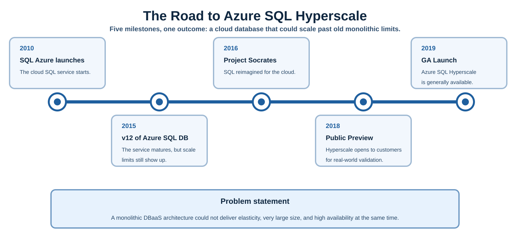

# Azure SQL Hyperscale Unveiled — Book Examples

Companion code for the forthcoming Apress book **Azure SQL Hyperscale Unveiled** by
**Bob Ward**. Every hands-on example in the book lives here, organized by chapter.

> **Short link:** this repo is referenced throughout the book as
> **`aka.ms/sqlhyperscalebook`**. Follow that link to reach the repo, then clone
> the URL shown by GitHub's **Code** button (or `gh repo clone`).

> **Status: pre-release.** Chapters are published here as the book is written.
> Folders appear as their chapters are finished.

## The scenario

The book runs one continuous scenario. **Collier Health** is a (fictional) health
system — the Azure SQL *logical server*, `collierhealth`. **Ward General Hospital**
is its flagship hospital — the Hyperscale *database*, `wardgeneral`. The story
grows from one hospital to a national health system, which is what motivates each
Hyperscale capability as the book advances.

**All data is synthetic. There is no real patient data (PHI) anywhere in this
repository — ever.** The dataset was **generated with AI assistance** and, while
plausible, **may not be a fully accurate representation of real medical, clinical,
laboratory, or billing data**. It is provided for **educational and illustrative
purposes only** and must **not** be used for clinical, diagnostic, or any
real-world healthcare decision-making.

## Layout

```
.github/skills/            Copilot skills — open this repo in VS Code and Copilot can
                           run them for you (e.g. "deploy my Hyperscale database")
examples/ch02-getting-started/  Getting started: provision, connect, build the schema, seed
examples/ch03-architecture/     Architecture: read-only DMV scripts that make the
                           Hyperscale tiers visible on the database from Chapter 2
examples/ch04-first-app/        The first app: a Blazor patient chart over the
                           Chapter 2 database, and the one connection it makes
examples/ch05-ai-ready-sql/     AI-ready SQL: embeddings, a vector index, in-engine
                           AI assistance and vector search — plus the APIM AI
                           gateway the engine calls through
examples/ch06-agentic-ai/       Agentic AI: a two-turn shift handoff over seven
                           bounded SQL MCP tools and an approval-gated write
examples/ch07-observability/    Observability: performance, availability, engine
                           events, retained errors, and connection history
examples/ch08-security/         Security: Row-Level Security in Ward General and
                           an optional bounded Azure SQL auditing investigation
                           ... (more added as chapters are completed)
figures/                   The book's architecture diagrams, as SVG, by chapter
```

Each chapter's scripts live under `examples/`; the Copilot **skills** that
orchestrate them live under `.github/skills/` so VS Code discovers them the
moment you open the repo.

The [database object catalog](examples/ch06-agentic-ai/OBJECT-CATALOG.md) maps
every reader-deployed object through Chapter 7 to its owning chapter, purpose,
and application, SQL, or MCP caller.

## Prerequisites

Install these before running the guided deploy:

**Editor + AI (to use the skill)**
- **VS Code** (current build).
- **GitHub Copilot** + **GitHub Copilot Chat** extensions, with **agent mode**, and a Copilot subscription. Skills are an agent-mode feature and are auto-discovered from this repo's `.github/skills/` the moment you open the folder.

**Shells / CLIs (what the scripts call)**
- **PowerShell 7+ (`pwsh`)** — required. The scripts use PowerShell 7 features, so Windows PowerShell 5.1 won't work. Set `pwsh` as your default integrated terminal.
- **Azure CLI 2.60+** (`az`) — signed in with `az login`.

**Database client (for connect-and-verify)**
- **MSSQL extension for VS Code** (`ms-mssql.mssql`) — the book's primary client; used to connect (Microsoft Entra auth) and run `connect-and-verify.sql`.

**Azure account**
- An **Azure subscription** with rights to create a logical server + database (Contributor or a SQL-specific role). See Chapter 2 for subscription options, including the free path. A Hyperscale database **bills from creation** — mind the meter.
- A **Microsoft Entra** account — you become the server's Entra admin (no SQL password needed to connect).

**Optional**
- **Azure MCP Server** (`ms-azuretools.vscode-azure-mcp-server`, preview) — lets Copilot drive `az` as structured tools. Not required: the skill runs `az` through the built-in terminal tool.

> **What "tools" does the skill use?** Mostly the **built-in terminal tool** that ships with Copilot agent mode — it runs `az` and the PowerShell script. Azure MCP is an optional add-on; the MSSQL extension is a client *you* drive, not an agent tool.

## Using the examples

Two ways, depending on how hands-on you want to be:

**Guided (recommended).** Clone via **`aka.ms/sqlhyperscalebook`**, open the
folder in **VS Code** with GitHub Copilot, and ask Copilot to *"deploy my
Hyperscale database."* It discovers the `deploy-hyperscale` skill in
`.github/skills/`, walks you through the key create-time decisions (region,
server name, redundancy, auth, size), and runs the deployment.

**By hand.** Open the chapter folder under `examples/` and run the PowerShell
scripts yourself in **PowerShell 7** — `./provision-hyperscale.ps1` (set any
overrides as `$env:*` first), then `./add-replicas.ps1` to finish the provision
step with a second HA replica and the `wardgeneral-research` named replica, then
run `01-schemas.sql` … `05-seed.sql` via the MSSQL extension or `sqlcmd`.

Either way, **scripts never hard-code secrets** — they read them from
environment variables or prompt you.

### Running the SQL scripts (and re-running them)

Run the five schema scripts **in order once**, then verify:

| Step | Script | What it does |
|---|---|---|
| 1 | `01-schemas.sql` | Creates the `clinical` and `ops` schemas. |
| 2 | `02-tables.sql` | Creates all 16 tables (keys, FKs, constraints, `json` columns). |
| 3 | `03-views.sql` | Creates the `vPatientChart` chart views. |
| 4 | `04-procedures.sql` | Creates the read/write procedures (admit, discharge, record vitals…). |
| 5 | `05-seed.sql` | Seeds the database to roughly **12 GB** of fully synthetic data. Runs ~5–15 min (log-rate gated). |
| ✓ | `verify-data.sql` | Read-only PASS/FAIL check. You want it to end with **`ALL CHECKS PASSED`**. |

**You never drop the database to start over.** Each script is safe to re-run,
but they differ in what they discard:

- `01` is a guarded no-op on re-run.
- **`02` drops and recreates the tables — this discards all data.** Re-run it
  only when you've changed the schema.
- `03` and `04` use `CREATE OR ALTER` — they redefine in place and touch no data.
- **`05` truncates and reseeds — it reloads the data without changing the
  schema.** This is the quick "give me fresh data" path.

So: to reload just the data, re-run **`05` alone**; to rebuild after a schema
change, re-run **`02`→`05`**. Dropping the *database* is never necessary and
would needlessly discard your compute shape, HA replica, and firewall rules.

### Why each script starts with `SET` options

Every `.sql` file opens with the same seven-line block:

```sql
SET QUOTED_IDENTIFIER ON;
SET ANSI_NULLS ON;
SET ARITHABORT ON;
SET CONCAT_NULL_YIELDS_NULL ON;
SET ANSI_PADDING ON;
SET ANSI_WARNINGS ON;
SET NUMERIC_ROUNDABORT OFF;
```

Those seven are the **exact settings SQL Server requires** to create a filtered
index, indexed view, computed-column index, or JSON index — if any one is wrong,
the `CREATE` fails with **Msg 1934**. `02-tables.sql` needs them for its filtered
unique index on `Encounter`, and `QUOTED_IDENTIFIER` / `ANSI_NULLS` are recorded
on the object at creation, so they also apply to later work (like the JSON index
added in a later chapter).

The preamble is in **every** file for portability: **SSMS** already defaults most
of these ON, but **`sqlcmd` defaults `QUOTED_IDENTIFIER` and `ARITHABORT` OFF**.
With the preamble, the scripts behave identically whether you run them from the
MSSQL extension, SSMS, or `sqlcmd` — so leave it in place and run each file whole.

## Figures

The book's architecture diagrams are published here as **SVG**, under
`figures/<chapter>/`. They are the source the printed figures are rendered from,
so they stay crisp at any zoom and you can open one and adapt it.



| Chapter | Figure | What it shows |
|---|---|---|
| 1 | [Timeline](figures/ch01-introduction/ch01-figure-01-timeline.svg) | How Hyperscale got here, from SQL Azure to GA. |
| 3 | [Architecture](figures/ch03-architecture/ch03-figure-01-architecture.svg) | The master figure: all four tiers and the paths between them. |
| 3 | [Primary compute](figures/ch03-architecture/ch03-figure-primary-compute.svg) | The primary replica and its local RBPEX cache. |
| 3 | [Log service](figures/ch03-architecture/ch03-figure-02-log-service.svg) | XLOG — the landing zone, the log broker, and who consumes the log. |
| 3 | [Page servers](figures/ch03-architecture/ch03-figure-page-server.svg) | The 128 GB slices and the `GetPage@LSN` path. |
| 3 | [File and storage](figures/ch03-architecture/ch03-figure-file-storage.svg) | The durable tier, and why you pay on actual allocation. |
| 3 | [Replicas](figures/ch03-architecture/ch03-figure-replicas.svg) | HA replicas, named replicas, and what attaches to what. |
| 3 | [Transaction flow](figures/ch03-architecture/ch03-figure-transaction-flow.svg) | One commit, followed across every tier. |
| 4 | [Application architecture](figures/ch04-first-app/ch04-figure-01-application-architecture-wide.svg) | The Ward General app, and the one connection it makes. |
| 5 | [Application architecture](figures/ch05-ai-ready-sql/ch05-figure-01-application-architecture.svg) | The same app once the engine itself calls out to models. |
| 6 | [Application architecture](figures/ch06-agentic-ai/ch06-figure-01-application-architecture.svg) | The same app once an agent, DAB and the SQL MCP server join it. |
| 8 | [Security architecture](figures/ch08-security/ch08-figure-01-application-architecture.svg) | The same app with provider context, Row-Level Security, and the production Private Link path. |

Chapters 4, 5, 6 and 8 are drawn on **one shared grid** on purpose. Put them
side by side and the layout does not move — only what has been added to it.

## License

The examples are licensed under the [MIT License](LICENSE).
