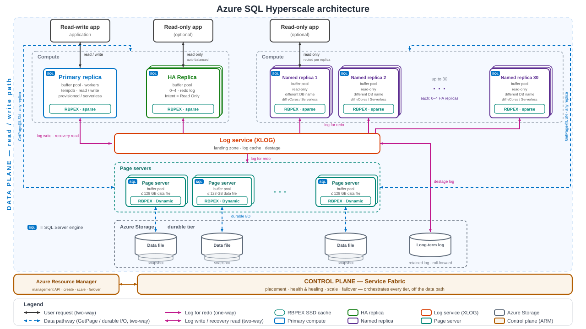

# Chapter 3 — Architecture

Make the Hyperscale architecture **visible** on the database you built in
Chapter 2. This chapter is a set of small, read-only scripts — one per chapter
section — that walk the DMVs surfacing each tier: primary compute, the log
service (XLOG), page servers, and the durable storage tier, plus how a
transaction flows across them, on the live **Ward General Hospital** database
(`wardgeneral`).

> **New here?** Read the [repository README](../../README.md) first — it covers
> the scenario, prerequisites, and how to stand up `wardgeneral`. These scripts
> assume that database already exists (see
> [Chapter 2](../ch02-getting-started/README.md)).



The chapter's other figures — primary compute, the log service, page servers,
file and storage, replicas, and one transaction followed across every tier —
are in [`figures/ch03-architecture/`](../../figures/ch03-architecture/),
listed with their captions in the [root README](../../README.md#chapter-3).

## What this is — and isn't

This is **architectural illustration only**. The queries show that the tiers
exist and how a request touches them; they do not benchmark or tune anything.
The same DMVs return as an **operational toolkit in Chapter 7** and as **tuning
instruments in Chapter 10** — here they simply make the chapter's architecture
concrete.

Run these on the `wardgeneral` **primary**. A couple of queries (role,
updateability) are also interesting when run against an HA or named replica.

## Files in this folder

One script per chapter section that has a DMV story. File numbers follow the
chapter's section numbers, so §7 (named replicas, folded into `06`) and §9
(summary, prose only) have no file of their own.

| File | Ch 3 § | What it surfaces |
|---|---|---|
| `01-four-tiers.sql` | §1 | One DMF, three tiers via `sys.dm_io_virtual_file_stats`: `file_id 2` = transaction log (XLOG), other rows = page-server ~128 GB slices, `database_id 0` = the compute-local RBPEX SSD cache. |
| `02-primary-compute.sql` | §2 | The compute replica: its process memory limit (`sys.dm_os_job_object`), the compute envelope from `sys.dm_user_db_resource_governance` (CPU, workers, sessions, local Data IOPS, 128 TB ceiling), and the `tempdb` files that share the local SSD budget with RBPEX. |
| `03-log-service.sql` | §3 | The governed log-rate ceiling (`primary_max_log_rate`), the XLOG file (`file_id 2`) write path, and which component is throttling log rate via `sys.dm_hs_database_log_rate`. |
| `04-page-servers.sql` | §4 | The page-server slices (`file_id <> 2` rows) and the remote `GetPage@LSN` path via `page_server_reads` in `sys.dm_exec_requests`. |
| `05-file-storage.sql` | §5 | Durable-tier allocation: allocated vs used vs max per file (`sys.database_files` + `FILEPROPERTY`), and whole-database allocation against the 128 TB ceiling — you pay on actual allocation. |
| `06-replicas.sql` | §6, §7 | The replica inventory (primary + HA + named on shared storage) via `sys.dm_hs_database_replicas`, self-joined on `parent_replica_id` so each HA replica shows **which parent it attaches to** — a named replica's HA replicas attach to the named replica, not the primary. Plus this connection's role / updateability. |

## Running them

Open any file against `wardgeneral` in the MSSQL extension, SSMS, or `sqlcmd`,
and run it top to bottom — they are independent and can be run in any order.
Every script reads only DMVs — it creates, alters, and deletes nothing, so it is
safe to run any number of times and on any replica. Each file opens with the
seven-line `SET`-options preamble so it behaves identically across all three
tools; see the [repository README](../../README.md) for that explanation.

A few queries return rows only on the **primary** (`03-log-service.sql` query 3
— `sys.dm_hs_database_log_rate` "returns rows only when the session is connected
to the primary replica").

`06-replicas.sql` is subtler: it runs anywhere, but **what you see depends on
where you stand.** The DMF only looks *down* the tree. From the primary you get
the whole inventory; from a named replica you get only that named replica and its
own HA replicas — the primary does not appear, because a named replica is a
separate database and `DB_ID()` resolves to it. Run it on the primary for the
full picture. From the primary, expect the primary and its HA replica, plus
`wardgeneral-research` **only if** you ran Chapter 2's optional
`add-replicas.ps1`. The nested HA-under-named-replica row in the book's Figure
3-11 came from the author's own test setup; no example here creates it.

The read/wait counts are more interesting after some activity: if the numbers
look flat, run a query or two against `wardgeneral` (for example the
`clinical.vPatientChart` view or `SearchEncounters` procedure from Chapter 2) in
another session, then re-run `01` and `04`.

## Permissions

Every script here is read-only, but DMVs are not readable by default — `db_owner`
alone is not enough. **Connect as an admin (the server admin you created in
Chapter 2 works as-is), or grant the database user `VIEW DATABASE STATE`:**

```sql
-- run in wardgeneral
GRANT VIEW DATABASE STATE TO [database_user];
```

That covers this folder. One caveat: `04` query 2 reads `sys.dm_exec_requests`,
which shows only your own session unless you can see server state. With
`VIEW DATABASE STATE` alone it runs but returns zero rows — which is also what a
quiet database looks like. An admin connection, or a login added to
`##MS_ServerStateReader##` (`ALTER SERVER ROLE [##MS_ServerStateReader##] ADD
MEMBER [login];` in `master`), sees other sessions' page-server reads.

Sources (accessed 2026-08-10):
[Monitor performance using dynamic management views](https://learn.microsoft.com/azure/azure-sql/database/monitoring-with-dmvs#permissions) ·
[System dynamic management views and functions](https://learn.microsoft.com/sql/relational-databases/system-dynamic-management-views/system-dynamic-management-views)

## Sources

The DMV usage is grounded in Microsoft Learn (accessed 2026-06-28):

- [Hyperscale performance diagnostics](https://learn.microsoft.com/azure/azure-sql/database/hyperscale-performance-diagnostics)
- [Hyperscale distributed functions architecture](https://learn.microsoft.com/azure/azure-sql/database/hyperscale-architecture)

## A note on the data

**All data is synthetic. There is no real patient data (PHI) here — ever.** The
dataset was generated with AI assistance and, while plausible, may not accurately
represent real medical, clinical, laboratory, or billing data. It is for
educational and illustrative purposes only and must not be used for clinical,
diagnostic, or any real-world healthcare decision-making.
