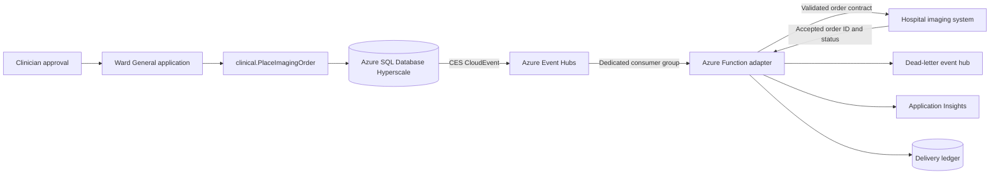

# Building an Imaging Order Application with Change Event Streaming

This design extends the Ward General scenario from Chapters 6 and 11. A clinician approves an imaging request, and the application calls `clinical.PlaceImagingOrder`. The procedure inserts an idempotent row into `clinical.ImagingOrder`. Azure SQL Database change event streaming (CES) publishes the committed insert to Azure Event Hubs. An Event Hubs-triggered Azure Function validates the event and submits an order to the hospital's imaging system.

The important boundary is that an inserted row records an intent. It does not schedule an X-ray, operate imaging equipment, or prove that a study occurred. The downstream imaging system remains responsible for accepting, scheduling, performing, and reporting the study.

CES is in preview as of September 17, 2026. This document is a build blueprint, not a record of a completed Ward General deployment. Recheck the CES documentation and rehearse the complete path before treating it as a production design.

## Architecture



The database contract and downstream adapter are independent. CES does not require the SQL application to know the imaging system's API, and the imaging system does not need database access.

## End-to-end flow

1. The application creates one `RequestKey` for the proposed order and shows the exact patient, encounter, modality, body site, and ordering provider to the clinician.
2. Only after approval, the application calls `clinical.PlaceImagingOrder` with the approved values and the same `RequestKey`.
3. The procedure derives `PatientId` from the active encounter, validates the provider, and inserts one `clinical.ImagingOrder` row. Its filtered unique index makes retries with the same `RequestKey` idempotent.
4. After the transaction commits, CES emits one row-level CloudEvent to Azure Event Hubs. The envelope identifies the operation, table, event, transaction, and current row values.
5. An Azure Function reads the event through a dedicated Event Hubs consumer group. It accepts only `INS` events from `wardgeneral.clinical.ImagingOrder`.
6. The function validates the CES schema version and required order fields, maps the row to the imaging system's contract, and authenticates to that system.
7. The imaging system returns an acknowledgement and its own order identifier. The function records that result in a delivery ledger keyed by `RequestKey`.
8. Transient failures are retried with bounds. Invalid or repeatedly failing events are copied to a dead-letter event hub with the original event ID and a failure reason so the main stream can continue.

## Components to build

| Component | Responsibility |
| --- | --- |
| Ward General order action | Collect approval and call `clinical.PlaceImagingOrder`; never insert directly into the table. |
| `clinical.ImagingOrder` | Durable clinical intent and source table for CES. |
| `clinical.PlaceImagingOrder` | Validate the write boundary, derive patient identity, and enforce `RequestKey` idempotency. |
| CES stream group | Publish committed changes from `clinical.ImagingOrder`. |
| Azure Event Hubs | Buffer the stream and decouple SQL from consumers. |
| Azure Function | Parse, validate, deduplicate, transform, submit, and observe each order event. |
| Delivery ledger | Record processing state and downstream acknowledgement without relying on Event Hubs retention as business state. |
| Dead-letter event hub | Isolate poison events and preserve enough evidence for repair and replay. |
| Application Insights and Azure Monitor | Measure function failures, dependency failures, event lag, throttling, and processing latency. |

## 1. Finish the order-entry path

Chapter 6 already defines the database-side contract:

- `clinical.ImagingOrder.RequestKey`
- `UQ_Imaging_RequestKey`, a filtered unique index
- `clinical.PlaceImagingOrder`

The application still needs an approval-gated action that invokes the procedure. Keep these rules:

- Generate the `RequestKey` before approval and reuse it for every retry of that approved request.
- Do not let a model or client provide `PatientId`; the procedure derives it from `EncounterId`.
- Do not grant the application direct `INSERT` permission on `clinical.ImagingOrder`.
- Do not report success as "X-ray scheduled." Report only that the order intent was recorded until the downstream system acknowledges it.
- Keep synthetic identifiers in demos. A real deployment must classify the event payload as health data and apply the organization's privacy, retention, and access policies.

## 2. Provision the event path

Create these Azure resources:

1. An Event Hubs namespace and an event hub for imaging-order changes.
2. A separate event hub for dead-letter events.
3. A dedicated consumer group for the imaging adapter.
4. An Azure Function App using the .NET isolated worker model and an Event Hubs trigger.
5. A storage account for the Function host's partition leases and checkpoints.
6. Application Insights for function, exception, and dependency telemetry.
7. A durable delivery ledger. This can be an integration table in SQL or another transactional store, but it must support an atomic "not processed / processing / delivered / failed" transition keyed by `RequestKey`.

Use managed identities rather than connection secrets:

- Give the Azure SQL logical server identity `Azure Event Hubs Data Sender` on the specific order event hub.
- Give the Function App identity receive access on the order event hub and send access on the dead-letter event hub.
- Give the Function App identity only the permissions required by the delivery ledger and downstream imaging API.
- Use private networking where the downstream system and Azure service topology support it.

The Event Hubs partition count limits useful Function parallelism. Start from measured order volume and downstream capacity. Do not scale the Function faster than the imaging system can safely accept orders.

## 3. Configure CES in `wardgeneral`

Run CES configuration in the user database as a principal with `CONTROL DATABASE` or membership in `db_owner`. Azure SQL Database already uses the required full recovery model.

For a new Azure SQL Database stream group, use `AzureEventHubs`. This destination uses the Kafka protocol. Do not use the deprecated `AzureEventHubsAMQP` or `AzureEventHubsApacheKafka` values for a new Azure SQL Database stream group.

```sql
USE wardgeneral;
GO

-- Create this only if the database does not already have a database master key.
CREATE MASTER KEY ENCRYPTION BY PASSWORD = '<strong deployment-time password>';
GO

CREATE DATABASE SCOPED CREDENTIAL CesEventHubsCredential
    WITH IDENTITY = 'Managed Identity';
GO

EXEC sys.sp_enable_event_stream;
GO

EXEC sys.sp_create_event_stream_group
    @stream_group_name = N'ImagingOrders',
    @destination_type = N'AzureEventHubs',
    @destination_location = N'<namespace>.servicebus.windows.net:9093/<event-hub>',
    @destination_credential = CesEventHubsCredential,
    @max_message_size_kb = 256,
    @partition_key_scheme = N'None';
GO

EXEC sys.sp_add_object_to_event_stream_group
    @stream_group_name = N'ImagingOrders',
    @object_name = N'clinical.ImagingOrder';
GO
```

The example uses round-robin partition selection because each imaging-order insert can be handled independently. If the design later requires ordering by a business key, choose and test a partitioning scheme that puts related events on the same partition. Do not assume ordering across Event Hubs partitions.

CES begins with changes committed after the table is added. It does not publish an initial snapshot of existing `clinical.ImagingOrder` rows. Configure and verify the stream before enabling the new application action, or create a separate reconciliation process for orders inserted during a gap.

Verify the configuration:

```sql
SELECT name, is_event_stream_enabled
FROM sys.databases
WHERE database_id = DB_ID();

SELECT name, is_replicated
FROM sys.tables
WHERE object_id = OBJECT_ID(N'clinical.ImagingOrder');

EXEC sys.sp_help_change_feed_settings;
EXEC sys.sp_help_change_feed;
EXEC sys.sp_help_change_feed_table
    @source_schema = N'clinical',
    @source_name = N'ImagingOrder';
```

## 4. Define the consumer contract

CES emits CloudEvents. For native JSON, the outer envelope includes these fields:

- `type`, currently `com.microsoft.SQL.CES.DML.V1`
- `id`, which identifies the event
- `logicalid`, `segmentindex`, and `finalsegment`, used when a large event is split
- `time`, the commit timestamp
- `operation`: `INS`, `UPD`, or `DEL`
- `data`, containing `eventsource` metadata and `eventrow.old` / `eventrow.current`

The `data` value and its `eventrow.current` value are JSON encoded inside strings, so the consumer performs nested deserialization. Reject or dead-letter an event unless all of these checks pass:

```text
type == com.microsoft.SQL.CES.DML.V1
operation == INS
eventsource.db == wardgeneral
eventsource.schema == clinical
eventsource.tbl == ImagingOrder
current.ImagingId is present
current.RequestKey is a nonempty GUID
current.EncounterId, current.PatientId, current.Modality, and current.OrderedById are present
current.Status == Ordered
```

Treat the CES envelope as an integration contract, not as the imaging system's public API. Map it into a small versioned domain message such as:

```json
{
  "contractVersion": 1,
  "requestKey": "2db49fa0-bab8-40c5-a45e-6e840d502754",
  "sourceOrderId": 90125,
  "encounterId": 418,
  "patientId": 207,
  "modality": "XR",
  "bodySite": "Chest",
  "orderedByProviderId": 31,
  "orderedAtUtc": "2026-09-17T14:32:11.120Z"
}
```

Only send fields the downstream system requires. If the receiving system expects FHIR or HL7, perform that mapping in the adapter and validate it against the receiving system's published profile. Do not label a custom JSON payload as FHIR or HL7.

## 5. Implement the Azure Function adapter

Use a .NET isolated-process Event Hubs-triggered Function. Keep CES parsing separate from imaging-system submission so both can be unit tested.

Suggested project structure:

```text
ImagingOrderAdapter/
|-- Functions/ProcessImagingOrder.cs
|-- Contracts/CesCloudEvent.cs
|-- Contracts/CesData.cs
|-- Contracts/ImagingOrderRequest.cs
|-- Services/CesEventParser.cs
|-- Services/ImagingOrderClient.cs
|-- Services/DeliveryLedger.cs
|-- host.json
|-- local.settings.json
`-- tests/
```

The handler's behavior should be equivalent to this pseudocode:

```csharp
foreach (var eventData in events)
{
    var cesEvent = parser.ParseAndReassemble(eventData);

    if (!cesEvent.IsImagingOrderInsert())
        continue;

    var order = cesEvent.ToImagingOrderRequest();

    if (await ledger.IsDeliveredAsync(order.RequestKey))
        continue;

    try
    {
        var acknowledgement = await imagingClient.SubmitAsync(
            order,
            idempotencyKey: order.RequestKey);

        await ledger.MarkDeliveredAsync(
            order.RequestKey,
            cesEvent.Id,
            acknowledgement.OrderId);
    }
    catch (TransientImagingSystemException)
    {
        throw; // Let the bounded Function retry policy run.
    }
    catch (Exception exception)
    {
        await deadLetter.WriteAsync(eventData, exception.Message);
        await ledger.MarkFailedAsync(order.RequestKey, cesEvent.Id, exception.Message);
    }
}
```

Production code must account for split CES events. Reassemble segments by `logicalid`, ordered by `segmentindex`, and process only after `finalsegment` is present. Alternatively, prove through schema and load tests that an imaging-order event always fits into one configured message and alert if a segmented event appears.

Use an `HttpClient` created by `IHttpClientFactory` for an HTTP-based imaging API. Obtain downstream tokens with the Function App managed identity or the organization's approved workload identity. Set explicit timeouts and bounded retries; do not retry validation failures or permanent 4xx responses.

## 6. Make delivery idempotent

Both CES and the Event Hubs-triggered Function provide at-least-once behavior. Duplicate processing is expected during retries, checkpoint recovery, and host changes.

Use two identifiers for different purposes:

- CES `source` plus `id` identifies a duplicate delivery of the same emitted event.
- `clinical.ImagingOrder.RequestKey` identifies the business request across application, database, CES, Function, and imaging system retries.

The imaging system should accept `RequestKey` as an idempotency key. If it cannot, the delivery ledger must atomically reserve the key before submission and reconcile uncertain outcomes. A timeout after submission is ambiguous: the adapter must query the downstream system by `RequestKey` before sending the order again.

Do not use an in-memory cache for deduplication. Function instances scale independently and restart.

## 7. Handle failures without blocking the stream

An Event Hubs trigger reads by partition and advances checkpoints as Function executions complete. One poison event must not prevent unrelated orders from progressing indefinitely.

Classify failures:

| Failure | Handling |
| --- | --- |
| Temporary timeout, throttling, or downstream unavailability | Bounded retry with backoff; preserve the same `RequestKey`. |
| Invalid CES envelope or unsupported schema version | Dead-letter immediately; alert. |
| Invalid clinical order values | Dead-letter; do not silently repair clinical data in the adapter. |
| Authentication or authorization failure | Stop repeated submissions, alert, and repair identity configuration. |
| Ambiguous downstream timeout | Query by `RequestKey`; submit again only if the downstream system confirms absence. |
| Repeated permanent failure | Dead-letter with event ID, request key, reason, attempt count, and timestamps. |

For a batch-triggered Function, catch failures per event and explicitly dead-letter permanent failures before the invocation returns. A function-level exception applies to the batch and can replay events that already succeeded. Begin with small batches or one-at-a-time processing while proving correctness, then tune batch size from measured throughput.

## 8. Observe the complete path

Monitor each layer rather than treating Function success as end-to-end success.

In Azure SQL Database, monitor:

```sql
SELECT *
FROM sys.dm_change_feed_errors
ORDER BY entry_time DESC;

SELECT *
FROM sys.dm_change_feed_log_scan_sessions
ORDER BY start_time DESC;
```

Also monitor transaction-log utilization. CES retains log records while it retries undelivered events. Persistent network, credential, message-size, or destination-throttling failures can therefore cause transaction-log growth. If Azure disables CES to protect the database, changes made while CES is disabled are not captured; reconfiguration alone does not backfill them.

In Event Hubs and the Function App, track:

- incoming events, outgoing events, throttled requests, and consumer lag
- Function executions, failures, retries, duration, and scale-out
- dead-letter count and oldest dead-letter age
- downstream API latency, status codes, and dependency failures
- time from SQL commit to downstream acknowledgement
- count of recorded order intents without a delivered or failed ledger record

Correlate telemetry with `RequestKey`, CES event `id`, `ImagingId`, and the downstream order ID. Do not log the full healthcare payload by default.

## 9. Test in phases

### Contract tests

- Parse representative CES `INS`, `UPD`, and `DEL` envelopes.
- Verify nested JSON deserialization and schema-version rejection.
- Verify that only `clinical.ImagingOrder` inserts produce submissions.
- Verify duplicate CES event IDs and duplicate `RequestKey` values produce one downstream order.
- Verify segmented events are reassembled or rejected explicitly.

### Integration tests

- Insert one order through `clinical.PlaceImagingOrder` and capture the raw Event Hubs event before filtering it.
- Confirm every required column and its actual serialized type.
- Simulate a downstream 429, timeout, 401, invalid payload, and permanent 500 response.
- Restart the Function between receipt and acknowledgement to force replay.
- Scale to multiple Function instances and prove deduplication remains correct.
- Change the table schema in a test database and prove the consumer handles or rejects the new event shape deliberately. CES does not emit a separate DDL event.

### Operational tests

- Disable downstream access and measure CES errors, Function lag, and SQL transaction-log growth.
- Restore access and measure recovery without duplicate downstream orders.
- Exercise a database failover and prove the current CES behavior before claiming automatic continuity.
- Disable and reenable CES in a test environment, insert rows during the gap, and prove the reconciliation process finds them.
- Replay dead-letter events after correcting the cause.

## Definition of done

The application is ready for a controlled pilot only when all of these statements are supported by captured evidence:

- A clinician-approved call creates exactly one `clinical.ImagingOrder` row for one `RequestKey`.
- CES emits the committed insert and the raw event matches the parser contract.
- The Function submits exactly one downstream order despite forced duplicate delivery and restart.
- Invalid events reach the dead-letter stream with enough evidence to repair and replay them.
- Operators can correlate SQL intent, CES event, Function execution, and downstream acknowledgement.
- Alerts fire for CES delivery errors, transaction-log pressure, consumer lag, dead letters, and downstream failures.
- A documented reconciliation query identifies database orders that have no terminal delivery-ledger state.
- The user interface distinguishes "order recorded," "submitted," "accepted," and "scheduled." It never equates the database insert with completion of the imaging study.

## Current CES constraints to design around

As of September 17, 2026:

- CES is a preview feature.
- Azure SQL Database requires `destination_type = N'AzureEventHubs'` for new stream groups; this uses Kafka. The prior AMQP destination is deprecated, and existing AMQP stream groups must migrate before support ends in April 2027.
- CES emits one event per affected row for `INSERT`, `UPDATE`, and `DELETE`; it does not emit DDL events.
- CES streams only changes made after enablement and provides no initial snapshot.
- Delivery is at least once, so consumers must be idempotent.
- CES cannot be enabled alongside CDC, transactional replication, Azure Synapse Link, or Fabric Mirrored Databases for SQL Server in the same database. Change tracking is supported.
- CES streams from the writable primary. Current documentation says it must be reconfigured after failover, restore, or migration; verify the exact behavior in the target environment.
- Each streamed column value larger than 1 MB is truncated without an error or warning before message chunking.
- CES delivery failures can prevent transaction-log truncation until delivery succeeds or CES is disabled.

## Sources

All sources accessed September 17, 2026.

- [Microsoft Learn - What is change event streaming (preview)?](https://learn.microsoft.com/sql/relational-databases/track-changes/change-event-streaming/overview)
- [Microsoft Learn - Configure change event streaming (preview) to Azure Event Hubs](https://learn.microsoft.com/sql/relational-databases/track-changes/change-event-streaming/configure)
- [Microsoft Learn - JSON message format - change event streaming](https://learn.microsoft.com/sql/relational-databases/track-changes/change-event-streaming/message-format)
- [Microsoft Learn - Frequently Asked Questions for Change Event Streaming](https://learn.microsoft.com/sql/relational-databases/track-changes/change-event-streaming/frequently-asked-questions-faq)
- [Microsoft Learn - Deprecation of AMQP protocol for change event streaming](https://learn.microsoft.com/sql/relational-databases/track-changes/change-event-streaming/amqp-deprecation)
- [Microsoft Learn - Azure Event Hubs trigger for Azure Functions](https://learn.microsoft.com/azure/azure-functions/functions-bindings-event-hubs-trigger)
- [Microsoft Learn - Reliable event processing with Azure Functions and Event Hubs](https://learn.microsoft.com/azure/azure-functions/functions-reliable-event-processing)
- [Microsoft Learn - Integrate Event Hubs with serverless functions on Azure](https://learn.microsoft.com/azure/architecture/serverless/event-hubs-functions/event-hubs-functions)
