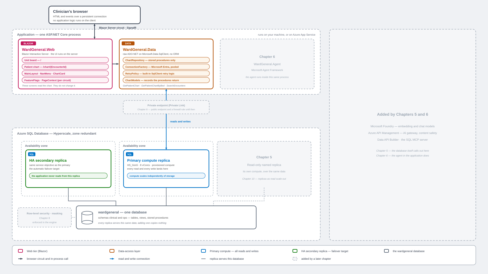

# Chapter 4 — Your First App

Build a real application on the database you provisioned in Chapter 2. **Ward
General Hospital** is a bedside chart: a unit board of occupied beds, a patient
chart assembled from one round trip, and an in-engine `REGEXP_*` note-signal
card. The app **reads**; the write procedures belong to the hospital's other
systems. It is an ASP.NET Core **Blazor** app on **.NET 10**
talking to `wardgeneral` over **raw ADO.NET** — no ORM — with a **passwordless**
Microsoft Entra connection.

> **New here?** Read the [repository README](../../README.md) first — it covers
> the scenario and prerequisites. This chapter assumes `wardgeneral` already
> exists with its schema and seed data (see
> [Chapter 2](../ch02-getting-started/README.md)).



The ghosted boxes are what Chapters 5 and 6 add. Those chapters redraw this same
figure on the same grid, so nothing moves — the additions simply become real.

This is the only example folder with a **build** step. Everything else in the
book is SQL or PowerShell.

## Requirements

Everything below is for building and running the Chapter 4 app itself. The
locked surfaces need more — an Azure OpenAI deployment for Chapter 5, Data API
Builder for Chapter 6 — but none of that is required here. The table in the
next section names what each one wants when you get to it.

**To build:**

| Requirement | Why |
|---|---|
| **.NET 10 SDK** or later | All three projects target `net10.0`. An older SDK fails with `NETSDK1045`, which reads like a project error rather than a missing install. Check with `dotnet --list-sdks`. |
| **PowerShell 7** | Every script here opens with `#requires -Version 7.0`. Windows PowerShell 5.1 will not run them. |
| A trusted **HTTPS developer certificate** | `dotnet dev-certs https --trust`. Without it the browser rejects the certificate and drops the Blazor circuit, which looks like an app bug. |

Nothing in the build touches Azure. You can compile the solution on a machine
with no sign-in and no database.

**To run:**

| Requirement | Why |
|---|---|
| **Azure CLI**, signed in with `az login` | The connection uses `ActiveDirectoryDefault`, and `DefaultAzureCredential` resolves that same sign-in. There is no password. |
| An identity that can reach the database | The app connects as **you**, not as a service account. Chapter 2 makes you the server's Entra admin, which is enough. |
| **`wardgeneral` with the Chapter 2 schema *and* its seed data** | Schema without seed gives you a working app with empty screens — a confusing place to land. |
| A **firewall rule** for this client's IP on the logical server | Otherwise the first data load times out. |
| Ports **7170** and **5170** free | Kestrel binds both. `shutdown.ps1` frees them. |
| A real browser | Not the VS Code Simple Browser — see the note under *Running it*. |

You do not have to check these by hand. `build.ps1` runs `preflight-build.ps1`
and `run.ps1` runs `preflight-run.ps1`, which verify all of it — including
counting patients to prove the seed ran — and name the fix for anything
missing. Run either on its own the first time you sit down with the code.

### Windows, macOS, or Linux

Nothing in this chapter is Windows-only. The .NET 10 SDK, PowerShell 7, and the
Azure CLI all run on macOS and Linux, and the app itself — Blazor Server over
`Microsoft.Data.SqlClient`, authenticating with an Entra access token — has no
platform dependency.

Three places in the scripts genuinely differ by operating system, and each one
branches:

| What | Windows | macOS and Linux |
|---|---|---|
| Opening your browser (`run.ps1`) | `Start-Process` | `open` / `xdg-open` |
| Finding which process holds a port (`shutdown.ps1`) | `Get-NetTCPConnection` | `lsof` |
| Loading the SQL client for the pre-flight check (`preflight-run.ps1`) | the `win` runtime, with managed networking forced on | the `unix` runtime |

**These were written for all three platforms but tested only on Windows.** If
you are on a Mac and something misbehaves, that is where to look first. The rest
of the book assumes Windows in places — Chapter 10's `sqlsim` load generator is a
Windows executable — so treat cross-platform as true for this chapter rather
than for the whole book.

## What this is — and isn't

The app is the book's through-line. It is written **once, here**, and never
gains per-chapter code deltas. Later chapters change the *database* — a new
proc, a new index, a security predicate — and the reader flips a **feature
flag**. Nothing in `src/` is edited again.

Which is why the app you run in Chapter 4 already contains surfaces you cannot
use yet. They are **greyed out, not hidden**: you can see what the app becomes
and which chapter gets you there.

| Surface | Flag | Unlocks in | Needs |
|---|---|---|---|
| **Research** page (sidebar) and the chart's **AI assistance** card | `Features:AiAssistance` | Chapter 5 | `06-ai-embeddings.sql`, `07-vector-index.sql`, `08-ai-assistance.sql`, `09-research-vector-search.sql` from [`examples/ch05-ai-ready-sql/`](../ch05-ai-ready-sql/) |
| **Chat icon** — the clinical assistant dock | `Features:AiAgent` | Chapter 6 | DAB running: `setup-dab.ps1` then `run-dab.ps1` in [`examples/ch06-agentic-ai/`](../ch06-agentic-ai/) |
| Row-level filtering behind the **"Viewing as"** selector | `RowLevelSecurity:Enabled` | Chapter 8 | The security predicate from [`examples/ch08/`](../ch08/) |

Row-level security is the one that looks like nothing is gated: the selector is
live in Chapter 4, it just doesn't filter. Chapter 8's payoff *is* the same
selector suddenly filtering.

Chapter 4 features are **not** flags. The base chart — including the `REGEXP_*`
card — is simply part of the app.

The Research page reads the **`wardgeneral-research` named replica**, which
already exists: [Chapter 2](../ch02-getting-started/README.md) deploys it with
`add-replicas.ps1`, and Chapter 3's `06-replicas.sql` surfaces it. Only the
Chapter 5 proc is missing.

## Files in this folder

| File | What it does |
|---|---|
| `WardGeneral.slnx` | The solution. Three projects, all under `src/`. |
| `build.ps1` | Restore + build. `-Clean` for a from-scratch build (stop the app first — see [Rebuilding from scratch](#rebuilding-from-scratch)), `-Configuration Release` to switch config. Runs `preflight-build.ps1` first. |
| `run.ps1` | Start the app and open your real browser. `-Server` / `-Database` override configuration for this run. |
| `restart.ps1` | Stop, then start. **This is how you flip a feature flag** — `-Enable` takes the complete list of flags to force on. |
| `shutdown.ps1` | Stop the app and free the ports. |
| `preflight-build.ps1` | Checks the .NET 10 SDK is present before building. |
| `preflight-run.ps1` | Checks `az login`, the server firewall, and that the database answers, before starting. `-SkipFirewall` to skip the firewall step. |

### The projects

| Project | What it is |
|---|---|
| `src/WardGeneral.Web` | The Blazor Web App (Interactive Server). Pages, layout, feature flags. |
| `src/WardGeneral.Data` | Class library. Raw ADO.NET over `Microsoft.Data.SqlClient`, one method per stored procedure. No ORM. |
| `src/WardGeneral.Agent` | The Chapter 6 assistant. Project-referenced by `Web` so it **compiles here in Chapter 4**; its UI stays locked until the `AiAgent` flag is on. |

`WardGeneral.Web` is the presentation layer and nothing more. It is an ASP.NET
Core Blazor application in **Interactive Server** render mode, so every component
executes on the server and the browser holds a circuit rather than a copy of the
application. Three routes make up the whole of it: the unit board at `/`, a
patient chart at `/chart/{EncounterId}`, and the research screen at `/research`.
Everything else is layout — `MainLayout`, `NavMenu`, `ChartCard`, the assistant
dock — and none of it knows a connection string. The project takes
`ChartRepository` and `ResearchRepository` by injection from `WardGeneral.Data`
and asks them for a chart; where that chart comes from, and which replica
answered, is decided a layer below. The one thing `Web` owns outright is
`FeatureFlags`, bound from configuration: it reveals each chapter's surface as
that chapter's SQL is deployed, without a source edit. The data layer never sees
it — a flag decides whether a card renders, not whether the procedure behind it
works.

## Build the Application

Building is entirely local. It needs the .NET SDK and nothing else — no Azure
sign-in, no subscription, no firewall rule, no database. That is worth knowing
before you start, because it means a failed build is always a toolchain problem
and never a cloud one.

There are two ways to do it. Ask Copilot, or run the script yourself. They do the
same thing — the skill runs the same `build.ps1` you would.

### What you need in VS Code

| Extension | Required? |
|---|---|
| **GitHub Copilot** ([`GitHub.copilot`](https://marketplace.visualstudio.com/items?itemName=GitHub.copilot)), with a Copilot subscription — [plans](https://github.com/features/copilot), [setup](https://code.visualstudio.com/docs/copilot/setup) | **Yes**, to drive the build with a prompt. Installing it also installs its companion, **GitHub Copilot Chat** ([`GitHub.copilot-chat`](https://marketplace.visualstudio.com/items?itemName=GitHub.copilot-chat)) — you do not install that separately. Not needed if you run the scripts by hand. |
| **MSSQL extension** | Not by the build. It is the book's baseline for running SQL, so you already have it from Chapter 2. |
| **C# Dev Kit** | No. The build is `dotnet build` from the terminal. Install it if you want to read and debug the source. |

Skills are an [agent-mode feature](https://code.visualstudio.com/docs/copilot/customization/agent-skills);
ask mode will not load one.

### The steps

1. **Install the prerequisites** — the .NET 10 SDK, PowerShell 7, and a trusted
   HTTPS developer certificate (`dotnet dev-certs https --trust`). The
   *Requirements* table above says why each one matters.
2. **Clone this repository and open the repository root in VS Code.** The root,
   not this folder: VS Code discovers Copilot skills from `.github/skills/`
   relative to the folder you open, so opening `examples/ch04-first-app/` on its
   own means the skill is never found. If VS Code was already open when you
   cloned, reload the window — a newly added skill folder is not picked up until
   you do.
3. **Open Copilot Chat and switch to agent mode.**
4. **Ask for the build:**

   > Build the Ward General app.

   Copilot loads the `wardgeneral-app` skill and runs the build for you.

Or skip steps 3 and 4 and run it yourself:

```powershell
./build.ps1
```

### The skill, and what it runs

The skill is [`.github/skills/wardgeneral-app/SKILL.md`](../../.github/skills/wardgeneral-app/SKILL.md)
in the repository root. It is a Markdown file — read it. It carries no code of
its own; it is instructions telling Copilot which of this folder's scripts to run
and in what order, so the agent path and the by-hand path stay the same path.

Phrases like *"build the app"*, *"run the Ward General app"*, or *"flip a feature
flag"* match it. For the build it reaches for one script:

| Script | What it does |
|---|---|
| `build.ps1` | Restores and builds `WardGeneral.slnx` — all three projects — with `dotnet build`. `-Configuration Release` switches configuration, `-Clean` deletes every `bin/` and `obj/` first (deliberately not `dotnet clean`, which only removes what the last build produced), `-Publish` runs `dotnet publish` on the web project into `src/WardGeneral.Web/publish`, and `-SkipPreflight` bypasses the check below. |
| `preflight-build.ps1` | Called automatically by `build.ps1` before anything compiles. Two checks, local only: the .NET SDK is major version 10 or later (a failure — an older SDK fails with `NETSDK1045`, which reads like a project error rather than a missing install), and the HTTPS developer certificate is present and trusted (a warning — it does not stop the build, but it will break the browser later). Run it on its own the first time you sit down with the code. |

The skill also owns running, restarting, and stopping the app. Those scripts are
the next section.

## Configuring the connection

No password appears anywhere. The connection uses
`Authentication=ActiveDirectoryDefault`, which resolves your `az login` identity
through `DefaultAzureCredential`.

`appsettings.json` ships the **shape, not the values** — `Server` is
deliberately empty. Supply yours in one of three places; **highest wins**:

1. `WardGeneral__Server` / `WardGeneral__Database` environment variables — what
   `run.ps1 -Server` sets
2. `appsettings.Development.json` — git-ignored, local to you
3. `appsettings.json` itself

If `Server` is still blank the app **fails at startup** and names all three
places. That is deliberate: a silent fallback to `localhost` is a worse first
five minutes than an explicit error.

## Running it

```powershell
./build.ps1
./run.ps1 -Server <your-server>.database.windows.net
```

Use the server you created in Chapter 2. The app listens on
`https://localhost:7170` (and `http://localhost:5170`) and opens your default
browser.

> Do **not** use the VS Code Simple Browser — it rejects the dev certificate and
> drops the Blazor circuit. `run.ps1` launches your real browser.

To stop:

```powershell
./shutdown.ps1
```

### Rebuilding from scratch

`build.ps1 -Clean` is the from-scratch build: it deletes every `bin/`, `obj/` and
`publish/` folder under `src/` and then builds, so nothing stale survives. That
is the whole of the application's state — there are no user secrets and no
generated files elsewhere — so a clean build really does start from nothing.

**Stop the app first.**

```powershell
./shutdown.ps1
./build.ps1 -Clean
```

A running app holds its own DLLs open, and Windows will not delete a file that is
in use. The deletion is deliberately written with `-ErrorAction SilentlyContinue`,
because a `bin/` folder that is partly missing is normal and not worth failing
over — but the consequence is that a locked file is skipped **silently**. The
script still prints `removing ...` for the folder, the build still runs, and you
are left with exactly the stale assembly you were trying to get rid of, with
nothing in the output saying so. Stopping the app first avoids the whole problem.

If you are rebuilding because you changed a feature flag rather than code, you do
not need `-Clean` at all — use `restart.ps1 -Enable <flag>`, which stops the app,
rebuilds and restarts it with the flag set.

Nothing here touches the database. `-Clean` rebuilds the *application*; the
Chapter 5 AI objects and the Chapter 2 schema have their own reset paths.

## Flipping a feature flag (later chapters)

```powershell
./restart.ps1 -Enable AiAssistance              # Ch 5 · AI card + Research
./restart.ps1 -Enable AiAgent                   # Ch 6 · chat icon (needs DAB)
./restart.ps1 -Enable RowLevelSecurity          # Ch 8 · the selector starts filtering
./restart.ps1 -Enable AiAssistance,AiAgent      # more than one
./restart.ps1                                   # back to the shipped defaults
```

Three things worth knowing:

- **`-Enable` is the complete list**, not an addition. Any flag you don't name
  is cleared back to what `appsettings.json` says, so a plain `./restart.ps1`
  always returns the app to its defaults. It has to work that way — the switch
  writes process environment variables, which would otherwise outlive the run.
- **A restart is required, a refresh is not enough.** Flags bind as
  `IOptions<FeatureFlags>`, resolved once at startup.
- **Use `restart.ps1`, not `run.ps1`.** `run.ps1` finds the old process still
  listening and simply reopens the browser at it, so the flag looks broken when
  it isn't.

No rebuild is involved. `run.ps1` uses `dotnet run`, so the app reads
`src/WardGeneral.Web/appsettings.json` from the project directory directly.
