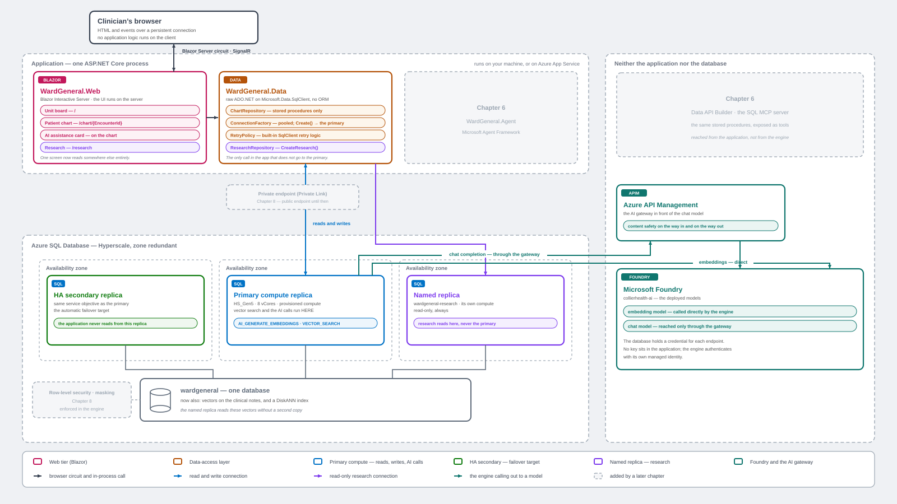

# Chapter 5 — AI-Ready SQL

Give the Ward General database an AI layer that lives **inside the engine**:
embeddings generated by T-SQL, a DiskANN vector index, semantic search over the
clinical-note corpus, and a stored procedure that calls a chat model and writes
what came back to an append-only ledger. Then put it on screen — the AI
assistance card on the patient chart and the Research page that runs its search
on the `wardgeneral-research` named replica.

> **Start here first.** This chapter builds on the database Chapter 2 creates.
> You need `wardgeneral` with the schema, the seeded data, **and the
> `wardgeneral-research` named replica** — `add-replicas.ps1` in
> [`../ch02-getting-started`](../ch02-getting-started) creates it, and the
> Research page below is the first thing that actually uses it. The application
> itself is Chapter 4, in [`../ch04-first-app`](../ch04-first-app).



This is the Chapter 4 figure on the same grid, with this chapter's boxes filled
in: Foundry, the gateway, the external model, the embeddings table and its
DiskANN index, and the two AI paths — clinical assistance on the primary,
patient search on the named replica. What is still ghosted belongs to Chapter 6.

## The flow

Four moves, in order. The first is a script; the middle ones are yours to run.

1. **Deploy the Azure AI resources** — `deploy-ai.ps1`. Foundry account, the
   `gpt-5` and `text-embedding-3-large` deployments, the logical server's
   managed identity, its role assignment, and (unless you pass `-NoGateway`) the
   APIM gateway with content safety.
2. **Replace the placeholders** in `06` and `08`. See below — a Foundry
   resource name is globally unique, so these scripts cannot ship with a working
   value baked in.
3. **Build the in-engine objects** — run `06` → `07` → `08` → `09` in order.
   `06` embeds the corpus, which is the long part; check it with
   `verify-embeddings.sql`. `07` is one statement, the vector index. `08` creates
   the assistance procedure already routed through the gateway — there is no
   separate step to turn governance on.
4. **Run the app** — `run-ai-app.ps1` builds the Chapter 4 application and
   starts it with the `AiAssistance` feature flag already on.

That is every SQL file you run. If you deployed with `-NoGateway` and later
change your mind, you re-run `08` rather than running anything new; see
[Adding the gateway later](#adding-the-gateway-later).

You can drive this through Copilot — ask it to *"get the Chapter 5 app running"*
and it runs the `ai-ready-app` skill — or work through it by hand as described
below. Either way **you run the SQL yourself.** That is deliberate: in Chapter 2
the schema DDL is the lesson, and here the T-SQL *is* the chapter. Automating it
away would automate away the subject.

## Before you start — tools, permissions, quota

Three things gate this chapter. Only the first is obvious, and the second is the
one that actually stops people.

### Tools

| You need | Why |
| --- | --- |
| **PowerShell 7+** (`pwsh`) | every script here is `pwsh`, not Windows PowerShell 5.1 |
| **Azure CLI 2.60+**, with `az login` done and `az account show` pointing at the subscription you mean | `deploy-ai.ps1` is a wrapper over `az` |
| **.NET SDK 10+** | the Chapter 4 application targets `net10.0` |
| **A SQL client you are comfortable in** — the MSSQL extension for VS Code, SSMS, Azure Data Studio, or `sqlcmd` | you run `06` → `09` yourself; every file carries its own `SET`-options preamble, so they all behave the same |

### Azure permissions

`deploy-ai.ps1` does two different kinds of work, and they need two different
kinds of rights. It **creates** resources, which Contributor can do — and then it
**grants those resources access to each other**, which Contributor cannot.

| What the script does | Rights it needs |
| --- | --- |
| Create the Foundry account and the `gpt-5` / `text-embedding-3-large` deployments | **Contributor** on the resource group (Cognitive Services Contributor also works) |
| Turn on the logical server's managed identity (`az sql server update --assign-identity`) | **Contributor**, or SQL Server Contributor |
| Create the APIM gateway and the Content Safety account | **Contributor** |
| Three role assignments — the server's identity and the gateway's identity each get **Cognitive Services OpenAI User** on Foundry, and the gateway's identity gets **Cognitive Services User** on Content Safety | `Microsoft.Authorization/roleAssignments/write` — **Owner**, **User Access Administrator**, or **Role Based Access Control Administrator** |

That last row is the one to check before you spend anything. **Contributor
cannot create role assignments** ([Microsoft Learn — Steps to assign an Azure
role](https://learn.microsoft.com/azure/role-based-access-control/role-assignments-steps#step-4-check-your-prerequisites),
accessed 2026-08-16). If that is all you have, the script gets as far as creating
Foundry and both model deployments — billable, and running — and then fails with
*"does not have authorization to perform action
'Microsoft.Authorization/roleAssignments/write'"*. Everything the chapter does
afterwards depends on that grant, because this chapter authenticates to Azure
OpenAI with a managed identity and no key.

Check yourself first:

```powershell
$sub = az account show --query id -o tsv
$me  = az ad signed-in-user show --query id -o tsv
az role assignment list --assignee $me `
  --scope "/subscriptions/$sub/resourceGroups/<your-rg>" `
  --include-inherited --query "[].roleDefinitionName" -o tsv
```

You want **Owner**, or Contributor *plus* one of User Access Administrator or
Role Based Access Control Administrator. If you have only Contributor, ask
whoever owns the subscription to make the three role assignments for you after
the resources exist — the script is safe to re-run once they have.

> `check-ai-env.ps1` will **not** catch this. Every call it makes is a read-only
> `GET`, so it can tell you whether a resource exists but not whether you are
> allowed to create one or to grant a role. A clean pre-flight is not a
> permissions clearance.

### Model quota

Each deployment asks for **capacity 100**. If the region has fewer than 100 units
free on either model, `deployment create` fails and the chapter has nothing to
embed with. Check before you deploy:

```powershell
$want = @('OpenAI.GlobalStandard.gpt-5','OpenAI.GlobalStandard.text-embedding-3-large')
az cognitiveservices usage list -l <your-region> -o json | ConvertFrom-Json |
  Where-Object { $want -contains $_.name.value } |
  ForEach-Object { '{0}  used {1} of {2}' -f $_.name.value, $_.currentValue, $_.limit }
```

Filter in PowerShell as shown rather than with `--query`. On Windows `az.cmd`
re-parses the argument and a JMESPath filter expression breaks before the CLI
ever sees it.

### Database permissions

To run `06` → `09` you connect as a principal with **CONTROL** on `wardgeneral`
— in practice `db_owner`, which is what the Chapter 2 admin login already has.
That covers creating the database-scoped credential and the external model, and
it implies **EXECUTE ANY EXTERNAL ENDPOINT**, the permission
`sp_invoke_external_rest_endpoint` requires
([Microsoft Learn — sp_invoke_external_rest_endpoint,
Permissions](https://learn.microsoft.com/sql/relational-databases/system-stored-procedures/sp-invoke-external-rest-endpoint-transact-sql#permissions),
accessed 2026-08-16). Nothing needs enabling first: the procedure is disabled by
default on SQL Server 2025 and Managed Instance, but not on Azure SQL Database,
which is what Hyperscale is.

## First — fill in `ch05.env`

Nothing in this chapter has a built-in default. A default resource name is
always *somebody's* environment, and a reader who forgets an argument would
silently aim at it. So your names go in one file, once:

```powershell
cd examples/ch05-ai-ready-sql
Copy-Item ch05.env.template ch05.env    # then open it and fill it in
./check-ai-env.ps1
```

`ch05.env` is git-ignored, so your names never land in a commit and your edits
never collide with a `git pull`. It is a plain `KEY=VALUE` file with a comment
over every entry explaining what the value is and where it is used. There are no
secrets in it — this chapter reaches Azure OpenAI with a managed identity, so
there is no key and no password anywhere in Chapter 5.

**The file stands on its own.** If you did Chapter 2, `RG` and `SRV` are the
values you already used and you can copy them straight across, but nothing here
reaches into another chapter to find them.

Every script in this folder reads these values, so you set them once:

| Value | Goes to |
|---|---|
| `RG`, `SRV`, `AI_RESOURCE`, `PUBLISHER_EMAIL`, `SUBSCRIPTION_ID`, `CS_RESOURCE` | `deploy-ai.ps1` |
| `AI_RESOURCE` | the `<your-foundry>` placeholder you paste into `06`, `08`, `10` |
| `APIM_NAME` | the `<your-apim>` placeholder, and `reset-ai-azure.ps1` |
| `WardGeneral__Server`, `WardGeneral__Database` | the app itself, so `run-ai-app.ps1` needs no `-Server` or `-Database` |

A variable already exported in your shell wins over the file, and the loader
tells you when that happens rather than overwriting it. If you would rather not
use the file at all, every script still takes explicit parameters.

### Check before you build: `check-ai-env.ps1`

```powershell
./check-ai-env.ps1          # add -NoGateway if you are skipping APIM
```

Read-only — every call is a GET, and it creates, changes and deletes nothing.
It reads `ch05.env`, stops if any value is still empty or still in
`<angle brackets>`, then reports each resource as **exists** or
**WILL BE CREATED**:

```
Resource                Name                            Status
--------                ----                            ------
Resource group          rg-contoso                      exists
SQL server              contoso-sql-01                  exists
Foundry account         contoso-ai                      exists
Model deployment        text-embedding-3-large          exists
APIM gateway            contoso-ai-gateway              WILL BE CREATED
```

**Read that list before you deploy.** Anything you expected to already have,
showing up as *will be created*, is a typo in `ch05.env` or the wrong
subscription — not a missing resource. Catching it here is free. Catching it
afterwards can mean a 30–45 minute APIM provision you did not want.

That warning lives here and nowhere else. `deploy-ai.ps1` does not repeat it: by
the time it is running the decision is made, and a caution you can no longer act
on is just noise. If the gateway row says **WILL BE CREATED** and you would rather
not spend the 30–45 minutes, this is the moment to add `-NoGateway`.

It also catches the one case where a re-run against a working environment still
creates something: `deploy-ai.ps1` finds Content Safety by the derived name
`<AI_RESOURCE>-contentsafety`, so if yours is called anything else **and you leave
`CS_RESOURCE` blank**, a run builds a second one beside it and re-points the
gateway policy at the new one. Filling in `CS_RESOURCE` is the whole fix — it is
the default for `deploy-ai.ps1`'s `-CsResourceName`, so the file passes it for you
and there is no switch to add.

## Before you run the SQL — replace the placeholders

Two of these values name resources that are **globally unique**, so no default
can work for you. Find and replace, throughout each file:

| Placeholder | Replace with | Appears in |
|---|---|---|
| `<your-foundry>` | Your Microsoft Foundry (Azure OpenAI) resource name | `06`, `08`, `10` |
| `<your-apim>` | Your API Management service name | `08`, `10` |

Use the **same** `<your-foundry>` value in every file. If you named the
embedding deployment something other than `text-embedding-3-large`, replace that
name in `06` too. Every affected file opens with a **BEFORE YOU RUN** block
naming exactly which placeholders it carries.

> **Why a literal placeholder and not a `@variable`?** The database-scoped
> credential's **name must exactly equal the endpoint URL** — SQL matches an
> outbound URL against a credential whose name is a URL prefix of it — and a
> credential name is an *identifier*. T-SQL has no variables in identifier
> position, so the value has to be in the text before the batch compiles. A
> literal also means the script runs unmodified in every client, with no
> variable-substitution mode to switch on.

## Files in this folder

| File | Type | What it does |
|---|---|---|
| `ch05.env.template` | Config | The template for your resource names. Copy it to `ch05.env` and fill it in — that file is git-ignored, so your names stay out of commits. Every entry carries a comment saying what it is and where it is used. No secrets: Chapter 5 is passwordless throughout. |
| `load-env.ps1` | PowerShell | Reads `ch05.env` into the environment. Creates the file from the template if it is missing, and refuses to continue while any value is still empty or still in `<angle brackets>`. A variable already exported in your shell wins over the file, and it says so. Dot-source it (`. ./load-env.ps1`) to keep the values for a whole session. |
| `check-ai-env.ps1` | PowerShell | **Read-only.** Reports what `ch05.env` names, what already exists in Azure, and what `deploy-ai.ps1` would therefore create. Run it before the deploy — a resource you expected to have, listed as *will be created*, is a typo or the wrong subscription. Also catches a Content Safety resource whose name is not the derived one, which is the single case where a re-run still creates something. |
| `deploy-ai.ps1` | PowerShell | The Azure side, in one command. Creates the Foundry account, both model deployments, the server's system-assigned managed identity and its **Cognitive Services OpenAI User** role, and — unless `-NoGateway` — APIM plus content safety. Stops at the edge of the database and prints the SQL run order. Idempotent. |
| `azureaideploy.ps1` | PowerShell | The worker `deploy-ai.ps1` calls. Run it directly if you want finer control over which pieces get created. |
| `setup-ai-gateway.ps1` | PowerShell | Provisions the APIM StandardV2 instance and wires the Foundry backend. A first provision takes ~30–45 minutes and is billable. |
| `add-content-safety.ps1` | PowerShell | Adds the input and output content-safety policies to the gateway. |
| `06-ai-embeddings.sql` | SQL | The external model, the credential, `clinical.ClinicalNoteEmbeddings`, and the embeddings themselves. The longest-running script here. |
| `07-vector-index.sql` | SQL | The DiskANN vector index over those embeddings. One statement, kept in its own file because it is the piece you may legitimately want to rebuild on its own — the vectors are hours of metered work, the index is not. |
| `08-ai-assistance.sql` | SQL | `clinical.GenerateClinicalAssistance`: retrieval over the corpus, a chat call through `sp_invoke_external_rest_endpoint` routed via the APIM gateway, and the append-only `clinical.AIAssistanceLog` ledger. Also creates the credential the gateway hop uses. |
| `09-research-vector-search.sql` | SQL | The retrieval-only procedure behind the Research page — semantic search with no chat step. Run it against the **primary**; because procedures live in shared storage, it is then callable on the `wardgeneral-research` named replica. This is the read scale-out beat: research queries get their own compute over the same page servers, with no data copy and no separate vector store. |
| `10-updateable-index-proof.sql` | SQL | Optional, and not part of the application. Proves the index is **updateable**: it embeds a query once, searches, inserts one note and its embedding, then runs the identical search against the same query vector and finds the new note at rank 1. Deletes it again and searches a third time. No rebuild anywhere. |
| `11-prompt-injection-proof.sql` | SQL | Optional, and not part of the application. Writes a textbook prompt injection into two ordinary chart fields — one diagnosis, one allergy — then calls the same procedure twice, once with `@UseGateway = 1` and once with `0`. **Both calls are refused, by two different controls.** The gateway returns 403 in ~630 ms from a policy you wrote; the direct path returns 400 after ~9,300 ms from Azure OpenAI's own Prompt Shields, which is on by default. The lesson is defence in depth, and which of the two controls is yours to configure. Removes the poisoned rows again. Requires `add-content-safety.ps1` to have run. |
| `verify-embeddings.sql` | SQL | Read-only check: notes vs embedded vs missing, the vector index, and the byte length of a stored vector (3,072 dimensions). |
| `reset-ai-objects.sql` | SQL | **The only script here that drops anything.** The "clean" option: removes the procedures, the vector index, the embeddings table, the external model and both credentials, in dependency order, so `06` → `09` can be run again from scratch. Never part of the normal flow — run it deliberately, and read its header first, because it discards every embedding. Leaves patient data and the ledger alone. |
| `reset-ai-azure.ps1` | PowerShell | The same idea one layer down: deletes what `deploy-ai.ps1` created — the role assignments, the APIM gateway, Content Safety and the Foundry account — in reverse dependency order, and **purges** each, because these resource types are soft-deleted and a name left reserved makes a rebuild recover the old resource instead of creating a new one. Supports `-WhatIf`; start there. `-KeepFoundry` rebuilds the gateway only and leaves your vectors valid. Never touches the resource group, the logical server or the database. |
| `run-ai-app.ps1` | PowerShell | Builds the Chapter 4 application and starts it with the `AiAssistance` feature flag on. |

## Running the SQL scripts (and re-running them)

Run them **in this order, once**:

| Order | File | Prerequisite |
|---|---|---|
| 1 | `06-ai-embeddings.sql` | `deploy-ai.ps1` has finished — the model deployment and the role assignment must exist before the external model can be used. |
| 2 | `07-vector-index.sql` | `06`, with at least 100 embedded notes. Below that it skips the index and says so; exact scan still works. |
| 3 | `08-ai-assistance.sql` | `06` — the procedure reads the table and external model `06` creates. Faster with `07`, correct without it. |
| 4 | `09-research-vector-search.sql` | `06`, for the same reason. Independent of `08`. |
| — | `10-updateable-index-proof.sql` | `07`, with the index actually created. Optional demonstration; inserts one note and removes it again, so it is safe to run any time and safe to repeat. It also sweeps on entry — the demo note carries the marker `DEMO-UPDATEABLE-INDEX-PROOF`, and the script deletes any note carrying it before doing anything else, so a run that died mid-way is repaired by re-running rather than leaving the corpus one note over. |
| — | `11-prompt-injection-proof.sql` | `08`, **and** a gateway built with content safety (`deploy-ai.ps1` without `-NoGateway`, or `add-content-safety.ps1` run against an existing gateway). Optional demonstration; it poisons two chart rows and deletes them again, so it is safe to run any time and safe to repeat. It makes two real model calls; both are refused before a completion is generated, so neither is billed for output. |
| — | `verify-embeddings.sql` | `06` has run at least once. Read-only; safe any time. |
| — | `reset-ai-objects.sql` | Only when you deliberately want to rebuild. Destructive; run it on its own, before `06`. |

Use whichever tool you prefer — the MSSQL extension in VS Code, SSMS, Azure Data
Studio, or `sqlcmd`. Every `.sql` file opens with the seven-line `SET`-options
preamble so it behaves identically in all of them. That preamble is not
decoration: `sqlcmd` does **not** default `QUOTED_IDENTIFIER`, `ANSI_NULLS` or
`ARITHABORT` to `ON`, and the vector and JSON indexes here fail without them.

### Expect `06` to be interrupted, and expect that to be fine

Embedding the full ~60,000-note corpus is roughly **3–3.5 hours** of round-trips
to the model — longer than a Microsoft Entra access token lives. Your connection
**will** be dropped part-way through. That is not a failure: the rows already
committed stay committed.

Reconnect and run the `INSERT` in step 4 of `06` again. `WHERE NOT EXISTS` means
it only embeds notes that have none yet, so each pass starts where the last one
stopped. Repeat until `verify-embeddings.sql` reports `MISSING=0`.

If you only want to see the mechanics rather than build the whole corpus, add a
`TOP (n)` to that `SELECT`. A few hundred notes is enough for the DiskANN index
to build and for both procedures to return real results.

### Re-running

`06` is written to be safe — and cheap — to re-run. Every object it creates is
created only if it is absent, and its `INSERT` fills gaps rather than starting
over. Nothing you have already paid for is thrown away.

That rule holds across the whole chapter: `06`, `07`, `08` and `09` create what
is missing and leave what is already there **alone**, printing which it did. The
reason is ordering as much as cost — an external model holds a reference to its
credential, so a script that drops and recreates both has to get the order right
or it fails twice on every second run, while the first run looks perfect.

Against a fully populated database a re-run of `06` therefore does nothing at all.
That is deliberate: it means you can rehearse the whole pre-flight sequence end to
end without regenerating the corpus. The corollary is that re-running cannot
**repair** anything — if an object exists but is wrong, see `reset-ai-objects.sql`.

- **Change the procedure logic** → re-run `08` or `09` freely. They are
  `CREATE OR ALTER` and touch no data.
- **Fill in missing embeddings** → re-run `06`. Its step-4 loop embeds only what
  is missing, 1,000 rows per committed batch, so it resumes rather than restarts.
- **Start the embeddings over** → `TRUNCATE TABLE clinical.ClinicalNoteEmbeddings`,
  then re-run `06` and `07`. The note corpus itself comes from Chapter 2's
  `05-seed.sql`, which is the only script that generates it.
- **Rebuild the vector index** → drop it (the last line of `07` is the statement,
  commented out) and re-run `07`. Rarely necessary — the index is updateable, so
  rows added later are indexed as they land — but it is quick, about 43 seconds
  over 60,000 vectors, and it never touches the vectors themselves.
- **Start the whole AI layer over** → `reset-ai-objects.sql`, then `06` onward.
  This is the expensive one: it discards every embedding, and rebuilding them is
  hours of metered model calls.
- **Rebuild the vector store from nothing** → drop
  `clinical.ClinicalNoteEmbeddings` yourself first, then re-run `06` and `07`.
  Deliberate and manual, because it throws away hours of work.
- **Switch between direct and gateway routing** — you do not need to re-run
  anything. The procedure takes both routes: `@UseGateway = 1` (the default)
  goes through APIM, `@UseGateway = 0` calls the deployment directly. Same
  payload, same result set — the returned `Path` column and the audit row tell
  you which one you got.

### If you re-run Chapter 2's `05-seed.sql`

Reseeding the database **removes everything in this folder's output**, and you
have to deploy `06`, `07` and `08` again afterwards.

The reason is foreign keys. Two tables created here point at data the seed owns —
`clinical.ClinicalNoteEmbeddings` at `ClinicalNote`, and `clinical.AIAssistanceLog`
at `Encounter` — and a foreign key blocks `TRUNCATE` outright, whether or not the
child holds a single row. So the seed drops both before it reloads. Embeddings
are derived data and meaningless once the notes they were computed from are gone,
so this is not a loss so much as a consequence: **the full embedding run has to
happen again, and it is the expensive step.** Reseed deliberately, not casually.

`clinical.AIAssistanceLog` is dropped rather than emptied because `08` creates it
as an append-only ledger table, which supports neither `DELETE` nor `TRUNCATE`
([Ledger considerations and limitations](https://learn.microsoft.com/sql/relational-databases/security/ledger/ledger-limits),
items 3 and 4). Dropping one is a soft delete by design — the object is renamed
to `MSSQL_DroppedLedgerTable_*` and physically retained so the ledger digest
stays verifiable ([DROP TABLE, Remarks](https://learn.microsoft.com/sql/t-sql/statements/drop-table-transact-sql#remarks)).
Each reseed leaves one more behind and **they are meant to stay.** Leave them.

## Adding the gateway later

If you deployed with `-NoGateway`, you followed the note in `08` and set
`@UseGateway`'s default to `0`. Nothing is lost — you can add the gateway
whenever you want:

1. Re-run `deploy-ai.ps1` **without** `-NoGateway`. It is idempotent; it creates
   the APIM instance and the content-safety policies and leaves everything else
   alone. A first provision takes ~30–45 minutes and is billable.
2. In `08`, replace `<your-apim>` with your API Management service name, put
   `@UseGateway`'s default back to `1`, and re-run the file. It is
   `CREATE OR ALTER`, so that is the whole of it — there is no separate
   "add the gateway" script to run.

The procedure's logic does not change — only the URL and the credential it
calls. Same chart read, same `VECTOR_SEARCH`, same prompt, same audit row, same
result set. Governance did not cost a rewrite; it cost a URL.

## When something comes back empty

An empty AI assistance card or a Research page with no results is almost always
one of three things, in this order of likelihood:

1. **The corpus is not embedded yet.** `VECTOR_SEARCH` has nothing to find. Run
   `verify-embeddings.sql` — if `MISSING` is large, re-run step 4 of `06`.
2. **The role assignment has not propagated.** Azure role assignments are not
   instant. Check with `az role assignment list --assignee <your server's
   managed identity object id> --all -o table` and look for **Cognitive
   Services OpenAI User**.
3. **The placeholder was never replaced**, so the credential name does not match
   the endpoint the procedure calls. The symptom is an auth failure that arrives
   suspiciously fast, before any HTTP call could have happened.

## A note on the data

**All data is synthetic. There is no real patient data (PHI) here — ever.** The
dataset was generated with AI assistance and, while plausible, may not
accurately represent real medical, clinical, laboratory, or billing data. It is
for educational and illustrative purposes only and must not be used for
clinical, diagnostic, or any real-world healthcare decision-making.

Model output is likewise illustrative. `clinical.GenerateClinicalAssistance`
writes a **suggestion** to a ledger for a clinician to confirm — it is not a
diagnosis, and nothing in this chapter should be read as one.
