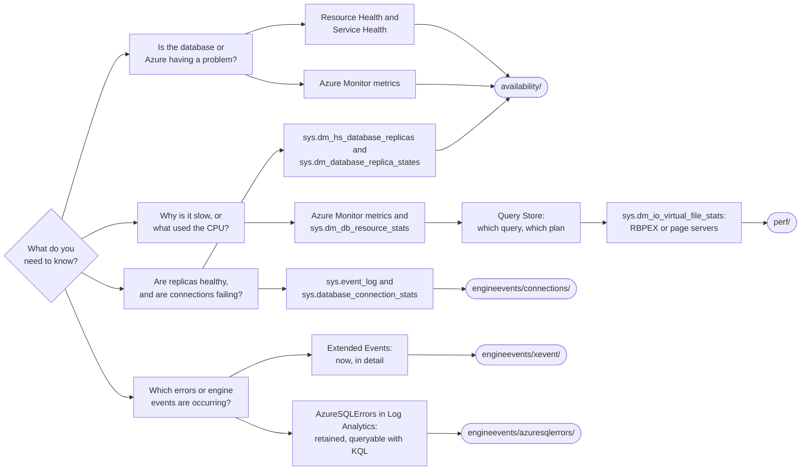

# Chapter 7 — Observability, Monitoring, and Troubleshooting

> **Figures:** this chapter's book figures are in [`figures/ch07-observability/`](../../figures/ch07-observability/),
> listed with their captions in the [root README](../../README.md#chapter-7).

Chapter 7 packages three bounded example surfaces with matching skills:
performance, availability, and engine events. Storage administration is not a
separate topic.
Activity Log was already demonstrated in Chapter 2 and appears only as an
inline callback here. Other queries, portal views, plans, and counters appear
inline in the chapter. Chapter 8 owns SQL auditing and Defender for SQL.

| Folder | Question | Status |
| --- | --- | --- |
| [`perf/`](perf/) | What caused the visible CPU spike, and how far did the reads travel? | Built and live-validated |
| [`availability/`](availability/) | What is the current Hyperscale replica and service-health state, and can Microsoft Copilot in Azure summarize the same evidence? | Built and live-validated |
| [`engineevents/`](engineevents/) | How can retained errors, current engine events, and connection history be inspected? | Log Analytics lifecycle built; database-scoped health session and `master` connection-history queries live-validated |

Use the canonical VS Code Chat invocations in [`prompts.md`](prompts.md).

### Which example answers which question

The book's *What to Use When* section has the full tables. This repository
supplement (not a book figure) follows the same questions to the tool and to
the example in this folder that shows it.

Start from the question, not the tool. Metrics and Resource Health tell you
*whether* something is wrong. DMVs and Query Store tell you *what* and *which
query*. Extended Events and AzureSQLErrors tell you *which errors*, now or over
time.

Start with the README inside the folder for the investigation being performed.
The examples diagnose and preserve evidence. They do not tune queries, scale
compute, create replicas, trigger failovers, configure auditing, or change
security policy; later chapters own those actions.

The availability walkthrough establishes the result first with Azure Resource
Health and repeatable SQL queries for replica role, synchronization, endpoint,
and topology. It states that the DMVs do not expose direct priming status. It
then asks Microsoft Copilot in Azure to
summarize Resource Health, relevant Service Health events, replica
synchronization, and dropped connections, with evidence sources and timestamps.
The reader compares that response with the portal and SQL results. Copilot is
an optional assistant, not the source of record; skip that step when preview
access is unavailable or its output cannot be independently verified.

> **New here?** Read the [repository README](../../README.md) first. The examples
> assume the Chapter 2 `wardgeneral` deployment and synthetic dataset already
> exist.

## Prerequisites

Every example in this chapter needs:

- **Chapter 2 complete** — `wardgeneral` deployed, `01`–`05` run, and
  `verify-data.sql` ending in `ALL CHECKS PASSED`. No application has to run.
- **PowerShell 7+** (`pwsh`).
- **Azure CLI** signed in with `az login`, with the subscription that holds the
  database selected (`az account show`).
- **The new Go-based `sqlcmd`** (not the legacy ODBC one). Check with
  `sqlcmd --version`; install with `winget install --id Microsoft.Sqlcmd`.
  The scripts connect passwordless with `sqlcmd -G`.
- **`examples/ch04-first-app/ch04.env`** filled in with `WardGeneral__Server`
  (full `.database.windows.net` name) and `WardGeneral__Database`. Add `RG=`
  only if your resource group isn't `rg-collierhealth`.
- **A Microsoft Entra identity that can read database state** — the Chapter 2
  Entra admin works. It reads Query Store and DMVs in `wardgeneral`.

Per example:

| Example | Also needs |
| --- | --- |
| `perf/` | Nothing more. Intentionally resource-intensive (three concurrent scans). |
| `availability/` | Microsoft Copilot in Azure only for the optional comparison step. Resource Health and Service Health come from the launcher (`az rest`, read-only). |
| `engineevents/xevent/` | Permission to create a database-scoped Extended Events session. |
| `engineevents/connections/` | Access to the logical server's `master` database. |
| `engineevents/azuresqlerrors/` | Rights to create a Log Analytics workspace and diagnostic setting in your resource group (Contributor). **Billable** until you run its teardown. |

**All data is synthetic. There is no real patient data (PHI) here.**

## You'll use these again in Chapter 10

Chapter 10's performance demos reuse the surfaces this chapter introduces and
add a few more. Each row links to the Chapter 10 script that queries it.

| DMV or view | In Chapter 7 | Chapter 10 scripts |
| --- | --- | --- |
| `sys.dm_db_resource_stats` | [perf/performance-drilldown.sql](perf/performance-drilldown.sql) | [measure.sql](../ch10-performance/01-scale-compute/measure.sql), [capture-growth-io.sql](../ch10-performance/02-grow-data/capture-growth-io.sql), [sample-growth-io.sql](../ch10-performance/02-grow-data/sample-growth-io.sql) |
| `sys.dm_io_virtual_file_stats` | [perf/run-performance-demo.ps1](perf/run-performance-demo.ps1) | [capture-growth-io.sql](../ch10-performance/02-grow-data/capture-growth-io.sql), [sample-growth-io.sql](../ch10-performance/02-grow-data/sample-growth-io.sql) |
| Query Store (`sys.query_store_query`, `_plan`, `_runtime_stats`) | [perf/performance-drilldown.sql](perf/performance-drilldown.sql) | [measure.sql](../ch10-performance/01-scale-compute/measure.sql), [memory-grant-feedback/02-run.sql](../ch10-performance/03-tune-grown-data/memory-grant-feedback/02-run.sql) |
| `sys.dm_db_wait_stats` (RBIO and `WRITELOG` waits) | — | [measure.sql](../ch10-performance/01-scale-compute/measure.sql), [capture-growth-io.sql](../ch10-performance/02-grow-data/capture-growth-io.sql), [sample-growth-io.sql](../ch10-performance/02-grow-data/sample-growth-io.sql) |
| `sys.dm_os_performance_counters` (RBPEX hit ratio) | — | [measure.sql](../ch10-performance/01-scale-compute/measure.sql) |
| `sys.dm_db_partition_stats` (table growth) | — | [capture-growth-io.sql](../ch10-performance/02-grow-data/capture-growth-io.sql), [sample-growth-io.sql](../ch10-performance/02-grow-data/sample-growth-io.sql) |
| `sys.dm_exec_query_stats` (memory grants and spills) | — | [memory-grant-feedback/02-run.sql](../ch10-performance/03-tune-grown-data/memory-grant-feedback/02-run.sql) |
| `sys.query_store_plan_feedback` (memory grant feedback) | — | [memory-grant-feedback/02-run.sql](../ch10-performance/03-tune-grown-data/memory-grant-feedback/02-run.sql) |

## Links from the book

Every web link printed in Chapter 7, in the order it appears, so you can click
instead of typing it. Cross-references to other chapters and links to this
repository are left out.

- Azure SQL Database resource limits — <https://aka.ms/azuresqlresourcelimits>
- Dynamic management views (DMVs) — <https://aka.ms/sqldmvs>
- Query Store — <https://aka.ms/querystore>
- Extended Events — <https://aka.ms/sqlxevents>
- AzureSQLErrors — <https://aka.ms/azuresqlerrors>
- Azure Monitor OpenTelemetry — <https://learn.microsoft.com/azure/azure-monitor/app/opentelemetry-enable>
- Application Insights — <https://learn.microsoft.com/azure/azure-monitor/app/app-insights-overview>
- GenAI gateway capabilities in Azure API Management — <https://learn.microsoft.com/azure/api-management/genai-gateway-capabilities>
