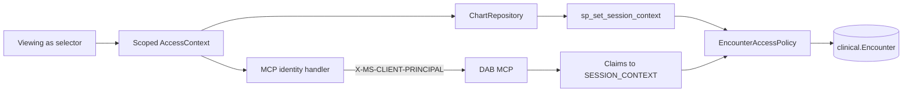

# Chapter 8 — Enforce Patient Access with RLS

This is the chapter's main example. The reader must have deployed the
Hyperscale database in Chapter 2 and built and deployed the application from
Chapters 4, 5, and 6. It does not repeat their setup. Chapter 8 adds one
security context that follows
the selected provider through both application data paths and is enforced by
one SQL Row-Level Security policy.

The complete setup, secured DAB, application startup, and provider pivot were
live-validated against `wardgeneral` on 2026-09-01. Encounter 200375 was visible
through the MCP chart tool to its attending provider 919 and returned no chart
to provider 925.

## Files

| File | Purpose |
| --- | --- |
| `00-inspect-rls-state.ps1` | Read-only check for recognized runtimes, generated files, and Chapter 8 RLS objects. |
| `00-reset-rls.ps1` | Stops recognized runtimes, removes only Chapter 8 RLS objects/generated files, and verifies a clean pre-Chapter 8 state. |
| `00-reset-rls.sql` | Drops the Chapter 8 policy and predicate, plus obsolete adapter procedures from earlier revisions. |
| `00-verify-clean.sql` | Confirms no Chapter 8 RLS objects remain. |
| `01-setup-rls.ps1` | Stops recognized app/DAB processes when present, deploys RLS, rebuilds, and generates and validates the secured DAB config. Then it exits. |
| `02-run-secured-dab.ps1` | Runs secured DAB visibly in the foreground. |
| `03-run-rls-app.ps1` | Runs the cumulative Ward General app visibly in the foreground and opens the browser. |
| `stop-local-apps.ps1` | Safely stops Ward General and a recognized DAB owner of port 5000; leaves unrelated listeners alone. |
| `probe-secured-mcp.ps1` | Waits up to 60 seconds for DAB, then sends a simulated authenticated principal and confirms the seven-tool MCP surface. |
| `test-secured-tool.ps1` | Calls one chart tool under an explicit simulated provider for bounded troubleshooting. |
| `new-client-principal.ps1` | Builds the local EasyAuth-compatible principal header used by the probe. |
| `enable-rls.ps1` | Runs the RLS SQL against the configured database with Microsoft Entra authentication. |
| `row-level-security.sql` | Creates the RLS predicate and security policy. |
| `verify-rls.sql` | Reports the owner of the walkthrough encounter and active-encounter counts by provider. |

## Run the example

In VS Code Chat, use this prompt as the complete entry point:

> Run the Chapter 8 RLS app demo

Every run begins with `00-inspect-rls-state.ps1`, which checks for recognized
Ward General or DAB processes, generated `_local` files, and Chapter 8 RLS
database objects without changing anything. Existing Chapter 8 objects are
normal installed state: the ordinary run prompt reuses them and starts DAB and
Ward General. Setup runs only when RLS has not been installed. A reset is
reserved for an explicit clean-state reinstall or proven object drift, and
always requires a preview and approval before anything is removed.

To run only the read-only inspection:

```powershell
./examples/ch08-security/rls/00-inspect-rls-state.ps1
```

To perform that reset manually instead, preview and then run:

```powershell
./examples/ch08-security/rls/00-reset-rls.ps1 -WhatIf
./examples/ch08-security/rls/00-reset-rls.ps1
```

The reset preserves all Chapter 4–6 application and database objects. It stops
the local runtimes and removes only Chapter 8 RLS objects and generated files.

First run setup from the repository root. It handles an app or DAB process that
is already running, prepares Chapter 8, and returns to the prompt:

```powershell
./examples/ch08-security/rls/01-setup-rls.ps1
```

Open a second visible terminal for DAB and leave it running:

```powershell
./examples/ch08-security/rls/02-run-secured-dab.ps1
```

The app preflight uses `probe-secured-mcp.ps1`, which waits up to 60 seconds for
DAB to finish startup and then requires exactly seven authenticated tools. In a
third visible terminal, start Ward General:

```powershell
./examples/ch08-security/rls/03-run-rls-app.ps1
```

The app opens at `https://localhost:7170`. Leave both runtime terminals open.
Press Ctrl+C in the app terminal to stop Ward General and in the DAB terminal to
stop DAB.

Script 03 uses the existing Chapter 4 restart path without weakening it. The
same Azure sign-in, firewall, database, and MCP preflight used by Chapters 4–6
runs before the app starts.

The setup script checks both states. If they are stopped, it continues. If Ward
General is running, it delegates to the existing app shutdown guard. If port
5000 is in use, it stops the owner only when the process identifies as DAB; an
unrelated listener is reported and left alone.

The script then:

- Deploy `row-level-security.sql` with the new Go-based sqlcmd and Microsoft
  Entra authentication.
- Rebuild the cumulative application because Chapter 8 changes its MCP identity
  transport and agent lifetime.
- Generate a Chapter 8 DAB config from Chapter 6's existing config under
  `rls/_local/`, outside the authored source.
- Enable DAB `set-session-context`, change DAB authentication from
  `Unauthenticated` to local `AppService` header simulation, and change the
  seven entity permissions from `anonymous` to `authenticated`.
- Validate the generated DAB configuration. Script 02 starts it visibly.
- Script 03 starts Ward General with `AiAssistance`, `AiAgent`, and
  `RowLevelSecurity` enabled; the app preflight sends an authenticated probe and
  requires exactly seven tools.

Use **Viewing as** on the unit board to compare **All providers · Admin** with
any attending provider in the dropdown. The list intentionally contains many
attendings; one provider is enough to demonstrate filtering, and switching to
others shows additional encounter subsets. Compare the unit board, open a
visible chart, and ask the assistant for the current handoff candidates. The
board, chart, and encounter-based MCP tools should pivot to the selected
provider.

## Behind the scenes

> **Book note:** The chapter's walkthrough names the unit-board view
> `clinical.vBedCensus`. In the repository the view is `ops.vBedCensus`
> (created in `examples/ch02-getting-started/03-views.sql`). It reads
> `clinical.Encounter` exactly as described, so the same policy filters it.

The selector writes `ProviderId`, `Role`, and the display name into the scoped
`AccessContext` for the current Blazor circuit. Chapter 8 makes
`WardGeneralAgent` scoped too, so one browser circuit cannot share another
circuit's acting identity.

The direct application path already calls `OpenWithContextAsync` whenever it
opens a SQL connection. That method writes `ProviderId` and `Role` with
`sys.sp_set_session_context`, then runs the existing query or stored procedure.

The agent path does not put identity in a prompt or tool argument. A dynamic
HTTP handler reads the same `AccessContext` immediately before each MCP request
and writes an EasyAuth-compatible `X-MS-CLIENT-PRINCIPAL` header. DAB's local
`AppService` provider treats that header as the authenticated principal. With
`data-source.options.set-session-context` enabled, DAB copies its claims into
SQL `SESSION_CONTEXT` before executing the selected stored procedure.

The two chart tools continue to call the Chapter 2 procedures
`clinical.GetPatientChart` and `clinical.GetPatientChartByBed`. DAB 2.0.9
already serializes their native SQL `json` output as strings. Neither procedure
takes an identity parameter: both read `clinical.vPatientChart`, whose
`clinical.Encounter` access is filtered by the DAB-provided session context.



Both routes arrive at the same predicate. Admin is allowed across the hospital.
An attending is allowed only where
`clinical.Encounter.AttendingProviderId` matches the session's `ProviderId`.
The model never receives permission to choose that value.

This laptop workflow simulates the identity header because Ward General is not
deployed behind App Service authentication. In production, EasyAuth or direct
Microsoft Entra JWT validation supplies the authenticated claims. The SQL
predicate and DAB claim-forwarding design remain the same.

## What pivots

RLS applies whenever the execution path reads `clinical.Encounter`. That
includes the unit board, patient charts, encounter search, handoff candidates,
handoff saves, and direct AI assistance for an encounter.

Historical similarity search is intentionally different. It searches the
Chapter 5 clinical-note corpus and does not join `clinical.Encounter`, so this
encounter policy does not turn it into provider-scoped patient authorization.
The Research page also uses its own named-replica connection and is outside this
RLS demonstration.

## Learning boundary

The policy permits sessions with no context so earlier chapter scripts,
background work, and diagnostics remain usable. The protected app routes do
carry context: direct ADO.NET stamps it explicitly, and secured DAB requires an
authenticated principal. This fail-open SQL branch is for the learning
environment. A production design should normally fail closed and establish a
separately authorized administrative path.

The **Viewing as** selector simulates acting identity; it is not a sign-in
control. No new database roles are created by this example.
