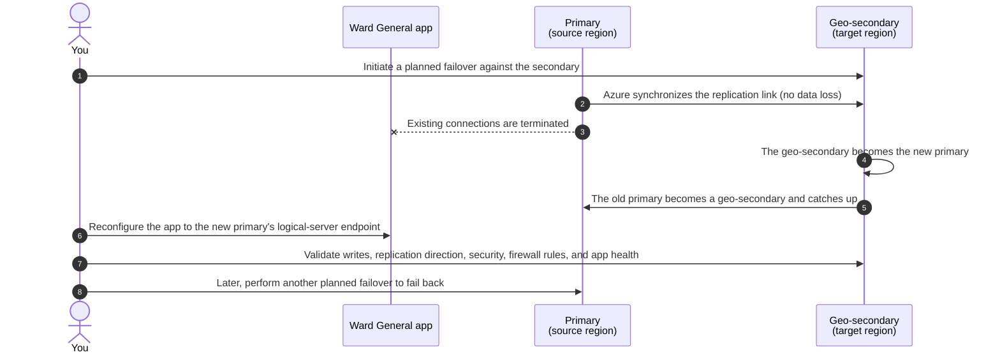

# Chapter 9 — Create a Hyperscale Geo-Replica

This demonstration creates a reader-named Entra-only logical server in another
Azure region — by default the **Azure paired region** of your source database's
region — then creates a Hyperscale geo-secondary of the existing `wardgeneral`
database on it. The source database remains online and writable while
transaction log is replicated asynchronously.

Book prompt (VS Code Copilot Chat, `deploy-wardgeneral-geo-replica` skill):
**Create the Ward General geo-replica**

The same workflow supports either TDE configuration a reader can bring from
the preceding chapters. If the source uses the default service-managed
protector, no Key Vault work is performed. If Chapter 8 switched the source to
a customer-managed key (CMK), the script grants the target server identity
access to that existing key and registers the key on the target before it
creates the geo-secondary. It never changes the source protector.

## Files

| File | Purpose |
| --- | --- |
| `deploy-geo-replica.ps1` | Reads the source from Chapter 4 configuration, previews the exact deployment, then creates the target server and geo-replica with `-Execute`. |
| `verify-geo-replica.ps1` | Verifies the source, target server identity, geo-secondary resource, and replication link from both sides. |
| `cleanup-geo-replica.ps1` | Previews the exact relationship and target resources, then removes the link and target server with `-Execute`. |

## Prerequisites

- Complete the Chapter 2 `wardgeneral` Hyperscale deployment.
- Fill in `examples/ch04-first-app/ch04.env`. This workflow uses
  `WardGeneral__Server` and `WardGeneral__Database` as its source of truth.
- Sign in with `az login` as the Microsoft Entra user who should administer
  the new logical server.
- Select the subscription containing your resource group (`rg-collierhealth`
  by default, or `RG=` in `ch04.env`).
- Ensure the signed-in identity can create SQL servers and databases and set
  the Microsoft Entra administrator.
- If the source uses a CMK, ensure the signed-in identity can grant the target
  server access to the source Key Vault and register that key with Azure SQL.
  The script supports both Key Vault access policies and Azure RBAC.
- Choose an available, globally unique Azure SQL logical server name. Use the
  same name as `-TargetServer` throughout deployment, verification, and cleanup.

## Deploy

Preview the exact deployment. This command reads configuration and Azure state
but changes nothing:

```powershell
./examples/ch09-ha-resiliency/geo/deploy-geo-replica.ps1 `
  -TargetServer '<unique-server-name>'
```

Confirm the subscription, source and its region, target and its region,
signed-in Entra administrator,
service objective, target HA replica count of zero, disabled target zone
redundancy, and backup redundancy. Also confirm the detected source TDE
protector. A service-managed protector reports that no CMK prerequisite is
required. A customer-managed protector reports the existing key and whether
its Key Vault uses access policies or Azure RBAC. The script creates the target
server with a system-assigned identity at server creation time; the portal
geo-replica experience does not offer that prerequisite and otherwise fails
with “The server identity is not correctly configured.”

### Target region

Geo-replication protects you only if the secondary is in a **different region**
from the source. The script reads the source database's region and, unless you
pass `-TargetLocation`, uses its [Azure paired region](https://aka.ms/azurepairedregions):

| Source region (Chapter 2) | Default target |
| --- | --- |
| `centralus` (the author's choice) | `eastus2` |
| `eastus2` (the Chapter 2 script default) | `centralus` |

To pick a different region, add `-TargetLocation <region>` to the deploy
command. The script refuses a target in the source's own region and checks
that the source's Hyperscale service objective is available in the target
region before it creates anything.

After explicit approval, run the same deployment with `-Execute`:

```powershell
./examples/ch09-ha-resiliency/geo/deploy-geo-replica.ps1 `
  -TargetServer '<unique-server-name>' `
  -Execute
```

The script creates:

- The reader-named logical server in the target region.
- A system-assigned identity on that server.
- Microsoft Entra-only authentication, with the signed-in Azure CLI user as
  the server administrator.
- For a CMK-protected source only, `Get`, `WrapKey`, and `UnwrapKey` access for
  the target server identity and registration of the existing source protector
  key on the target server. An RBAC-enabled vault uses the **Key Vault Crypto
  Service Encryption User** role; an access-policy vault uses the equivalent
  three key permissions.
- A `wardgeneral` Hyperscale geo-secondary that matches the source service
  objective and backup redundancy but has no HA replicas and is not zone
  redundant.

The lower-cost target still protects against loss of the source region
because its page servers and compute are in the target region. It does not
have a hot local HA standby or availability-zone distribution there. If its
compute fails, Azure must create replacement compute before the geo-secondary
is available again, so local recovery can take longer.

Geo-replica creation is asynchronous and includes the initial seeding described
below. Wait until Azure reports the database online, then verify it:

```powershell
./examples/ch09-ha-resiliency/geo/verify-geo-replica.ps1 `
  -TargetServer '<unique-server-name>'
```

Require `GeoReplicaVerification=PASS`. The geo-secondary is read-only until a
geo-failover promotes it. Replication is asynchronous with respect to commit,
so the primary does not wait for the geo-secondary before acknowledging a
transaction.

## Supplement: initial seeding comes before log replication

This repository supplement makes explicit a setup step not covered in the
book's geo-replication discussion: **a new Hyperscale geo-replica must first be
seeded from snapshots of the primary database's physical storage before it can
start pulling changes from the log service.** The log stream alone does not
provide the existing database contents.

1. **Seed the data.** Azure uses storage snapshots to establish the initial
   database contents in the target's own storage, served by its own page
   servers.
2. **Catch up and keep up.** After seeding, the geo-replica pulls changes from
   the primary's log service to catch up, then continues asynchronous log
   replication as the primary accepts new transactions.

**Azure performs this seeding automatically as part of geo-replica creation.**
There is no separate reader-run backup, restore, or synthetic-data seed script.
The primary remains online and writable during setup.

Unlike HA and named replicas, a geo-replica **does not share the primary's page
servers or storage**, even when it is in the same region. This example creates
it in another region, so the initial data must be copied there. Allow for a
size-of-data operation, not just the time to start another compute replica;
snapshot-based seeding does not make a cross-region data copy instantaneous.
Do not treat a submitted creation request as an already protected database:
wait for creation to finish and run the verification above.

See [Microsoft Learn: Hyperscale geo-replicas](https://learn.microsoft.com/azure/azure-sql/database/service-tier-hyperscale-replicas#geo-replica)
for the separate page-server architecture and initial data-copy requirement.

## Supplement: a planned geo-failover, step by step

This diagram is a repository supplement to the book's *The Failover Process*
section for standalone geo-replication. It is not a book figure, and it follows
the book's steps without adding any. The scripts in this folder **do not**
perform a failover.



Ways to initiate the failover, as listed in the book: PowerShell
`Set-AzSqlDatabaseSecondary`, `az sql db replica set-primary`, T-SQL
`ALTER DATABASE [database] FAILOVER` on the geo-replica, the Azure portal's
**Failover** option, or the REST APIs.

- **Forced failover** follows the same steps without step 2, because the
  primary isn't synchronized first (for example, PowerShell
  `-AllowDataLoss`). You might not fail back until the original primary is
  running again.
- **Failover group:** applications that connect through the listener name are
  redirected to the new primary automatically (after a retry), so step 6 isn't
  needed.

> **If you try a failover on this example's replica,** fail back before running
> cleanup. `cleanup-geo-replica.ps1` deletes the database on the target server,
> which would be your primary after a failover.

## Clean Up

Preview cleanup only after geo-replication testing is complete:

```powershell
./examples/ch09-ha-resiliency/geo/cleanup-geo-replica.ps1 `
  -TargetServer '<unique-server-name>'
```

The preview identifies the source that will be retained, the replication link,
the geo-secondary, and the target logical server. After explicit approval:

```powershell
./examples/ch09-ha-resiliency/geo/cleanup-geo-replica.ps1 `
  -TargetServer '<unique-server-name>' `
  -Execute
```

Cleanup removes the replication link and deletes the named target server,
including its secondary database. It refuses to delete a server that lacks
the Ward General sandbox ownership tags or contains another database. It never
deletes or modifies the source logical server or source `wardgeneral` database.

## Boundaries

- Deployment and cleanup preview by default and require explicit approval
  before `-Execute`.
- The target server and geo-secondary are billable resources.
- The target region defaults to the source region's Azure pair and must differ
  from the source region. Existing targets must carry the Ward
  General sandbox ownership tags; cleanup also refuses a server containing an
  unexpected database.
- The source server and database come from `ch04.env`; no server name, password,
  or connection string is embedded in these scripts.
- The workflow detects the source server-level TDE protector. It neither
  enables CMK for readers who skipped that Chapter 8 option nor replaces,
  rotates, or removes a source CMK.
- The target deliberately uses zero HA replicas and no zone redundancy to keep
  this DR example's compute cost lower. It does not match the source's local
  availability topology.
- This creates standalone active geo-replication, not a failover group.

References:

- [Microsoft Learn — Configure active geo-replication](https://learn.microsoft.com/azure/azure-sql/database/active-geo-replication-configure-portal), accessed 2026-09-08.
- [Microsoft Learn — Hyperscale secondary replicas](https://learn.microsoft.com/azure/azure-sql/database/service-tier-hyperscale-replicas#geo-replica), accessed 2026-09-08.
- [Microsoft Learn — Microsoft Entra service principals with Azure SQL](https://learn.microsoft.com/azure/azure-sql/database/authentication-aad-service-principal), accessed 2026-09-08.
